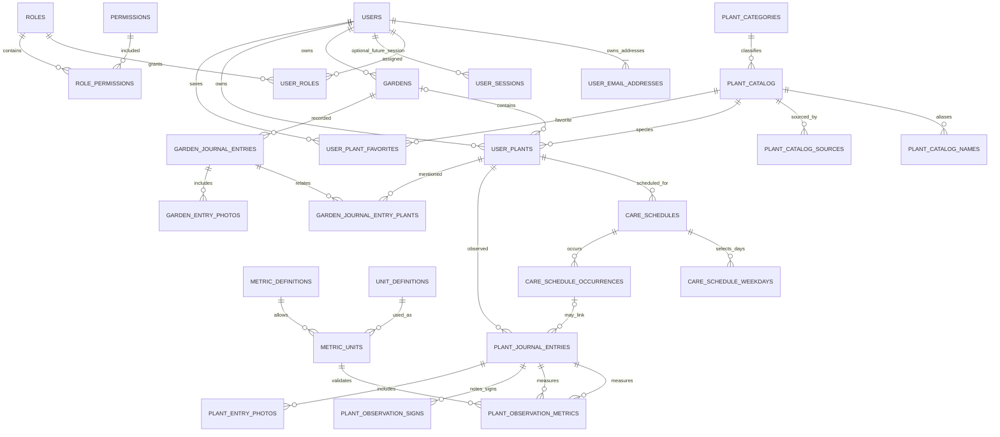

# GoPlant — Đề xuất thiết kế cơ sở dữ liệu PostgreSQL

> Tài liệu thiết kế, chưa phải schema đã triển khai. Backend Spring Boot/PostgreSQL chưa có trong repository. Không có bảng hay migration nào được tạo trong database.

## 1. Phạm vi, nguồn và mức độ xác nhận

Đề xuất này tổng hợp (1) source frontend hiện có, (2) PDF mô tả thành phần chức năng hệ thống GoPlant, (3) PDF yêu cầu bảo mật dạng nháp, và (4) các quyết định nghiệp vụ bạn vừa cung cấp. PDF chức năng ghi chú danh sách chức năng còn có thể thay đổi; vì vậy các phần ghi **cần chốt** không nên được xem là yêu cầu đã đóng.

### Đã xác nhận từ source và quyết định của bạn

- Frontend dùng Expo SDK `~57.0.32`, React `19.2.3`, React Native `0.86.3`, Expo Router `~57.0.30`, TypeScript `~6.0.3`; route nằm trong `src/app/` và UI/logic tính năng ở `src/features/`.
- User đăng nhập bằng email. Đổi email được phép nhưng cần xác minh; quy trình xác minh có thể triển khai sau.
- Có vai trò `admin` (quản trị hệ thống) và `user` (người dùng app). Admin quản lý/cấp vai trò và quyền.
- Người dùng không chia sẻ cây/vườn. Cây đã sở hữu được gắn tối đa một vườn; có thể chưa gắn vườn. Cây chỉ đang tìm kiếm/yêu thích không phải cây sở hữu và không được gắn vào vườn.
- Dữ liệu danh mục cây do admin quản lý; nội dung chi tiết cần nguồn tham khảo đáng tin cậy.
- Chưa triển khai cảm biến thật. Các giá trị môi trường trong ghi nhận, nếu người dùng nhập/quan sát, là dữ liệu thủ công, không phải telemetry.
- Quy định xóa tài khoản, retention và backup chưa được chốt.

### Đã thấy trong frontend nhưng hiện chỉ là state hoặc nội dung demo

- `AuthSession` giữ session trong RAM; mock auth chỉ dành cho development. Không dùng tài khoản mock làm tài khoản production.
- `PlantDataStore` có hồ sơ cây gồm catalog, tên hiển thị, vị trí, ngày trồng/bắt đầu chăm sóc, ghi chú và favorites; dữ liệu hiện mất khi ứng dụng khởi động lại.
- Form vườn, lịch chăm sóc, nhật ký, thông tin môi trường và thông báo chưa ghi dữ liệu lên server. Một số màn hình chi tiết dùng dữ liệu minh họa.
- PDF mô tả nhiều trường/luồng chưa có trong UI hiện tại, ví dụ trạng thái sức khỏe theo lịch sử, giai đoạn phát triển, kích thước đo, nhiều ảnh, nhật ký vườn và quản lý lặp lịch. Các bảng tương ứng bên dưới là mục tiêu thiết kế theo tài liệu, không phải tuyên bố chúng đã được triển khai.

## 2. Quy tắc thiết kế

1. Dữ liệu cá nhân luôn có chủ sở hữu; mọi API đọc/sửa/xóa phải kiểm tra quyền ở backend theo user đang xác thực, không tin `user_id` do client gửi.
2. Danh mục cây dùng chung do admin có quyền phù hợp quản lý; user thường chỉ được đọc/tìm kiếm.
3. Tách **loài cây trong danh mục** khỏi **cây cụ thể người dùng đang sở hữu**. Dữ liệu chăm sóc tham khảo không phải trạng thái thực tế của cây người dùng.
4. Mọi nhật ký/ghi nhận môi trường là dữ liệu do người dùng nhập hoặc quan sát, trừ khi sau này tích hợp cảm biến thật và có provenance riêng.
5. Dùng `timestamptz` cho instant/thời điểm thực tế (PostgreSQL lưu instant, không giữ timezone gốc); dùng `date` cho ngày lịch như ngày trồng và ngày occurrence địa phương.
6. Dùng `uuid` làm PK, snake_case cho bảng/cột; tương thích Spring Boot/JPA qua `UUID`, migration Flyway là nguồn schema duy nhất.
7. Không lưu mật khẩu rõ, token phiên rõ, hoặc ảnh nhị phân trực tiếp trong bảng nghiệp vụ.

## 3. Tổng quan bảng

| Bảng | Mục đích | Căn cứ |
|---|---|---|
| `users`, `user_email_addresses` | Tài khoản, địa chỉ email chính/chờ xác minh và hồ sơ tối thiểu | Form đăng ký/đăng nhập, yêu cầu SC-03/04; unique constraint áp dụng trên cả địa chỉ chính/chờ |
| `roles`, `permissions`, `user_roles`, `role_permissions` | RBAC: vai trò và quyền | Quyết định admin/user; yêu cầu admin cấp quyền, SC-01/06 |
| `user_sessions` | Thu hồi phiên/refresh token khi logout hoặc hết hạn | Future, chỉ thêm nếu backend tự quản lý refresh session |
| `account_action_tokens` | Token xác minh/đổi email/reset password | Future, chỉ thêm khi các luồng này vào backend scope; chỉ lưu hash |
| `plant_categories`, `plant_catalog`, `plant_catalog_names`, `plant_catalog_sources` | Danh mục cây, lọc/tìm kiếm, điều kiện trồng và nguồn dữ liệu | PDF chức năng, admin quản lý danh mục và SC-06/07; chỉ dữ liệu đã review/duyệt mới được công khai |
| `metric_definitions`, `unit_definitions`, `metric_units` | Danh mục metric, unit và các cặp hợp lệ | Quyết định chuẩn hóa metric/unit; chưa có danh sách code hay giá trị seed được xác nhận |
| `gardens` | Vườn/không gian do user sở hữu | Form vườn và PDF chức năng |
| `user_plants` | Cây cụ thể user sở hữu; tối đa gắn một vườn | Model `OwnedPlant`, quyết định ownership và PDF thêm cây |
| `user_plant_favorites` | Cây catalog được lưu/yêu thích, chưa phải cây sở hữu | UI favorites/wishlist và bộ lọc cây yêu thích |
| `care_schedules`, `care_schedule_weekdays`, `care_schedule_occurrences` | Quy tắc lặp lịch và từng lần đến hạn/thực hiện | PDF lập/xem lịch chăm sóc; bảng weekday lưu các thứ được chọn cho recurrence |
| `plant_journal_entries`, `plant_observation_metrics`, `plant_observation_signs`, `plant_entry_photos` | Nhật ký/ghi nhận thủ công theo thời gian, số đo, dấu hiệu quan sát và ảnh | PDF nhật ký, theo dõi và so sánh mốc; code set phải được kiểm soát, không nhận mã tùy ý |
| `garden_journal_entries`, `garden_journal_entry_plants`, `garden_entry_photos` | Nhật ký cho vườn, có thể liên kết nhiều cây | PDF chỉnh sửa nhật ký vườn |
| Push devices/deliveries, inbox | **Không thuộc MVP**; không thiết kế hay tạo trong giai đoạn này | MVP dùng nhắc cục bộ trên thiết bị; xem mục 12 |

Chưa đề xuất bảng cảm biến hoặc số đo tự động vì bạn xác nhận chưa cần. Các rủi ro SC-09 yêu cầu xác định backup/khôi phục nếu có, nhưng chưa quy định retention/backup cụ thể.

## 4. Tài khoản, vai trò và phiên

### 4.1. `users`

| Cột | PostgreSQL | Ràng buộc / ý nghĩa |
|---|---|---|
| `id` | `uuid` | PK |
| `display_name` | `varchar(120)` | NOT NULL |
| `password_hash` | `varchar(255)` | NOT NULL nếu tự xác thực mật khẩu; chỉ hash bằng password hashing chuyên dụng |
| `status` | `varchar(24)` | NOT NULL; CHECK `pending_verification`, `active`, `disabled`, `locked`; `active` bắt buộc có email primary đã xác minh |
| `timezone` | `varchar(64)` | NOT NULL DEFAULT `Asia/Ho_Chi_Minh`; timezone IANA mặc định theo hồ sơ user, có thể đổi |
| `created_at` | `timestamptz` | NOT NULL |
| `updated_at` | `timestamptz` | NOT NULL |

Nếu giữ `email` và `pending_email` ở hai cột trên `users`, unique index riêng không ngăn email của user A trùng pending email của user B. Vì vậy thiết kế ưu tiên chuẩn hóa email vào bảng `user_email_addresses` dưới đây; không dùng trigger dò hai cột làm mặc định. Trigger dùng advisory lock đơn lẻ không chứng minh chống race dưới READ COMMITTED do snapshot của statement có thể cũ. Bảng email identity là đề xuất chuẩn hóa kỹ thuật cần review trước khi migration.

Quy tắc đã chốt: mỗi user có đúng một email primary; user chỉ được chuyển sang `active` khi email primary đã xác minh. User ở `pending_verification` vẫn có primary nhưng `verified_at` còn NULL. Vì email và trạng thái nằm ở hai bảng, CHECK thông thường không đủ; service phải cập nhật trong transaction và DB cần deferred constraint trigger (hoặc cơ chế constraint tương đương) để kiểm tra đúng một primary ở cuối transaction và `active` chỉ đi cùng primary đã xác minh. Kiểm thử race condition khi tạo/promote email là điều kiện trước migration. Chuẩn hóa email (`trim/lowercase`) tại service; DB UNIQUE toàn cục là lớp bảo vệ cuối.

Điện thoại không được dùng làm username theo yêu cầu hiện tại. Các trường hồ sơ như ngày sinh/giới tính trên UI hiện là demo; chưa đưa vào schema vì chưa có yêu cầu nghiệp vụ.

### 4.1.1. `user_email_addresses`

`id uuid PK`; `user_id uuid NOT NULL FK users ON DELETE CASCADE`; `normalized_email varchar(320) NOT NULL UNIQUE CHECK (normalized_email = lower(trim(normalized_email)))`; `address_type varchar(20) NOT NULL CHECK IN ('primary','pending_change')`; `verified_at timestamptz NULL`; `created_at timestamptz NOT NULL`. Chuẩn hóa email bằng trim/lowercase trước khi insert. Partial UNIQUE (`user_id`) WHERE `address_type='primary'` và partial UNIQUE (`user_id`) WHERE `address_type='pending_change'` bảo đảm tối đa một địa chỉ chính và một địa chỉ đổi đang chờ. UNIQUE toàn cục trên `normalized_email` chặn collision giữa email chính và pending email của mọi user. Mỗi user phải có chính xác một primary; tạo user, địa chỉ primary và đổi trạng thái phải hoàn tất trong cùng transaction, với deferred constraint trigger/service validation ở commit để kiểm tra invariant xuyên bảng.

Địa chỉ pending không dùng để đăng nhập. Khi đổi email, email primary cũ tiếp tục dùng để đăng nhập cho đến khi email mới được xác minh; sau đó promote địa chỉ mới thành primary và gỡ/giải phóng địa chỉ cũ trong cùng transaction. Không cho phép trùng địa chỉ pending đang chờ cho cùng một tài khoản. Bảng này thay cho các cột `email`, `email_verified_at`, `pending_email` trên `users`.

### 4.2. `roles`, `permissions`, `user_roles`, `role_permissions`

| Bảng.cột | PostgreSQL | Ràng buộc |
|---|---|---|
| `roles.id` | `uuid` | PK |
| `roles.code` | `varchar(40)` | NOT NULL, UNIQUE; seed tối thiểu `admin`, `user` |
| `roles.name` | `varchar(100)` | NOT NULL |
| `permissions.id` | `uuid` | PK |
| `permissions.code` | `varchar(80)` | NOT NULL, UNIQUE; ví dụ permission theo use case, cần chốt danh sách |
| `permissions.description` | `text` | NULL |
| `user_roles.user_id` | `uuid` | FK `users(id)` ON DELETE CASCADE |
| `user_roles.role_id` | `uuid` | FK `roles(id)` ON DELETE RESTRICT |
| `user_roles.assigned_by` | `uuid` | FK `users(id)` ON DELETE SET NULL; actor cấp vai trò |
| `user_roles.assigned_at` | `timestamptz` | NOT NULL |
| `role_permissions.role_id` | `uuid` | FK `roles(id)` ON DELETE CASCADE |
| `role_permissions.permission_id` | `uuid` | FK `permissions(id)` ON DELETE CASCADE |

PK kép lần lượt là (`user_id`, `role_id`) và (`role_id`, `permission_id`). Seed `admin` với toàn bộ permission được định nghĩa và `user` với permission thông thường; mọi lần thêm permission mới phải cập nhật role-admin mapping. Chỉ admin được gán/thu hồi role theo quyết định hiện tại. Bảo vệ admin cuối cùng trong transaction backend: tuần tự hóa thao tác cấp/thu hồi admin bằng transaction-scoped advisory lock hoặc khóa phù hợp, đọc lại số admin còn hoạt động rồi từ chối thao tác làm số đó bằng 0. Không giới hạn cứng số admin; khuyến nghị vận hành ít nhất hai. Cần audit log cho thao tác cấp/thu hồi admin trước khi bật quản trị thực tế; audit log để giai đoạn sau, nhưng là điều kiện vận hành. Không thể đảm bảo quy tắc cuối-admin chỉ bằng CHECK constraint thông thường.

### 4.3. Authentication, JWT và `user_sessions` (có điều kiện)

| Cột | PostgreSQL | Ràng buộc / ý nghĩa |
|---|---|---|
| `id` | `uuid` | PK |
| `user_id` | `uuid` | NOT NULL, FK `users(id)` ON DELETE CASCADE |
| `refresh_token_hash` | `varchar(255)` | NOT NULL, UNIQUE; không lưu token nguyên |
| `created_at` | `timestamptz` | NOT NULL |
| `expires_at` | `timestamptz` | NOT NULL, CHECK sau `created_at` |
| `revoked_at` | `timestamptz` | NULL; logout/revoke |
| `last_used_at` | `timestamptz` | NULL |

Hướng đã chốt nếu GoPlant tự quản lý xác thực: Spring Security và JWT. Access token ngắn hạn là JWT, không lưu vào bảng. Nếu cần thu hồi/đăng xuất từng thiết bị hoặc refresh token, lưu hash refresh token trong `user_sessions`; không lưu token rõ. Thời hạn access/refresh, thuật toán ký, rotation và việc bắt buộc lưu session theo thiết bị chưa được chốt, nên `user_sessions` vẫn là bảng có điều kiện. Mật khẩu chỉ lưu bằng password hashing an toàn; thuật toán và tham số cụ thể phải được chọn cùng cấu hình Spring Security, không chốt trong tài liệu database. Mock session hiện tại trong frontend không phải phiên production.

### 4.4. `account_action_tokens` (Future, khi triển khai xác minh)

Nếu backend tự xử lý xác minh email/đổi email/đặt lại mật khẩu, đề xuất `account_action_tokens(id uuid PK, user_id uuid FK users ON DELETE CASCADE, purpose varchar(24) CHECK IN ('EMAIL_VERIFICATION','EMAIL_CHANGE','PASSWORD_RESET'), token_hash varchar(255) UNIQUE NOT NULL, target_email varchar(320) NULL, expires_at timestamptz NOT NULL, consumed_at timestamptz NULL, created_at timestamptz NOT NULL)`. Sinh token bằng nguồn ngẫu nhiên an toàn, chỉ lưu hash, dùng một lần và hết hạn; rate limit được thực thi ở service/gateway. Không cho phép nhiều yêu cầu pending trùng email đích cho cùng user. Thời hạn, ngưỡng rate limit và provider gửi email chưa chốt. Tạo bảng bằng migration riêng khi xác minh/đổi email/reset password thực sự được triển khai; nếu dùng provider ngoài thì đối chiếu mô hình của provider.

## 5. Danh mục cây do admin quản lý

### 5.1. `plant_categories`

`id uuid PK`; `code varchar(50) NOT NULL UNIQUE`; `name varchar(100) NOT NULL`; `sort_order integer NOT NULL DEFAULT 0`; `is_active boolean NOT NULL DEFAULT true`; `created_at`, `updated_at timestamptz NOT NULL`; `created_by`, `updated_by uuid FK users`.

Danh mục khởi tạo theo tài liệu: cây cảnh, rau, cây ăn quả, hoa, cây gia vị, cây dược liệu, khác. Các mã cần ổn định để filter/API không phụ thuộc chuỗi tiếng Việt hiển thị. Chỉ admin được tạo/sửa/ngừng hoạt động category.

### 5.2. `plant_catalog`

| Cột | PostgreSQL | Ràng buộc / ý nghĩa |
|---|---|---|
| `id` | `uuid` | PK |
| `category_id` | `uuid` | NOT NULL, FK `plant_categories(id)` ON DELETE RESTRICT |
| `common_name` | `varchar(200)` | NOT NULL |
| `scientific_name` | `varchar(240)` | NULL nếu chưa biết |
| `difficulty` | `varchar(16)` | NULL; CHECK `easy`, `medium`, `hard` |
| `light_need` | `varchar(32)` | NULL; enum/mã chuẩn cần thống nhất, ví dụ direct/bright_indirect/medium_indirect/low |
| `water_need` | `varchar(16)` | NULL; CHECK `low`, `medium`, `high`; mô tả chi tiết có thể bổ sung |
| `environment` | `varchar(24)` | NULL; CHECK `indoor`, `outdoor`, `both` |
| `size_class` | `varchar(16)` | NULL; CHECK `very_small`, `small`, `medium`, `large`, `very_large` |
| `mature_height_cm` | `numeric(8,2)` | NULL, CHECK > 0 khi có giá trị |
| `mature_width_cm` | `numeric(8,2)` | NULL, CHECK > 0 khi có giá trị |
| `temperature_min_c` / `temperature_max_c` | `numeric(5,2)` | NULL; min <= max nếu cả hai có |
| `humidity_min_pct` / `humidity_max_pct` | `numeric(5,2)` | NULL; từng giá trị 0..100, min <= max |
| `soil_type` | `text` | NULL; mô tả đất/giá thể |
| `drainage_guidance` | `text` | NULL |
| `soil_ph_min` / `soil_ph_max` | `numeric(3,1)` | NULL; min <= max, giá trị hợp lệ 0..14 |
| `sun_tolerance` | `varchar(32)` | NULL; mã/giá trị chuẩn hóa sau khi thống nhất |
| `growth_rate` | `varchar(16)` | NULL; CHECK `slow`, `medium`, `fast` |
| `lifespan` | `text` | NULL; mô tả/phân loại có nguồn |
| `flowering_season` | `text` | NULL; chỉ khi áp dụng và có căn cứ |
| `watering_guidance` | `text` | NULL; hướng dẫn, không phải lịch user |
| `nutrition_guidance` | `text` | NULL |
| `origin` | `text` | NULL |
| `overview` | `text` | NULL |
| `morphology` | `text` | NULL |
| `usage_and_caution` | `text` | NULL |
| `representative_image_key` | `text` | NULL; object key/asset reference, không lưu binary |
| `is_active` | `boolean` | NOT NULL DEFAULT `true`; ẩn/ngừng thay vì xóa catalog đang được tham chiếu |
| `publication_status` | `varchar(24)` | NOT NULL; chỉ bản ghi đã qua review và được duyệt mới hiển thị cho user; mã trạng thái cụ thể cần chốt trước migration |
| `reviewed_by`, `reviewed_at` | `uuid`, `timestamptz` | NULL cho tới khi duyệt; reviewer FK `users(id)`; đề xuất để thể hiện provenance review |
| `created_by`, `updated_by` | `uuid` | FK `users(id)`; ghi nhận admin thao tác |
| `created_at`, `updated_at` | `timestamptz` | NOT NULL |

Ràng buộc số học: `temperature_min_c <= temperature_max_c`, mỗi humidity trong 0..100 và `humidity_min_pct <= humidity_max_pct`, mỗi pH trong 0..14 và `soil_ph_min <= soil_ph_max` khi có giá trị. Không đặt ngưỡng giả. Các trường chỉ lưu nếu admin có nguồn xác thực; khuyến nghị lưu dẫn chứng ở `plant_catalog_sources` cho đúng các field được hỗ trợ.

Quy trình đã chốt ở mức nghiệp vụ: admin chỉnh sửa dữ liệu và cung cấp nguồn cho các trường có nguồn yêu cầu; trước khi user nhìn thấy catalog, dữ liệu phải được review/duyệt. Tài liệu chưa xác nhận tên/mã trạng thái, nên `publication_status` và `reviewed_by`/`reviewed_at` là đề xuất kỹ thuật cần chốt mã trước migration. Backend chỉ trả các bản ghi đã duyệt và đang active. Không seed giá trị chăm sóc chưa có nguồn. Không có versioning/rollback catalog trong MVP; lịch sử chỉnh sửa đầy đủ là Future.

### 5.3. `plant_catalog_names` và `plant_catalog_sources`

- `plant_catalog_names`: `id uuid PK`, `plant_catalog_id uuid FK ON DELETE CASCADE`, `name varchar(200) NOT NULL`, `name_type varchar(24) NOT NULL CHECK IN ('alias','local')`, `language_code varchar(16) NULL`; unique trên (`plant_catalog_id`, `lower(name)`). `common_name` và `scientific_name` là tên chuẩn trên `plant_catalog`; bảng này chỉ chứa tên bổ sung, không lặp tên chuẩn. Backend cần từ chối alias trùng case-insensitive với tên chuẩn của cùng cây; không dùng tên hiển thị làm ID.
- `plant_catalog_sources`: `id uuid PK`, `plant_catalog_id uuid FK ON DELETE CASCADE`, `source_title varchar(240) NULL`, `source_url text NULL`, `accessed_at timestamptz NOT NULL`, `supports_fields text[] NOT NULL`, `added_by uuid FK users ON DELETE SET NULL`, `created_at timestamptz NOT NULL`. CHECK yêu cầu ít nhất một trong `source_title` hoặc `source_url` có giá trị không rỗng; `supports_fields` không rỗng và chỉ dùng mã trường catalog đã thống nhất. Một cây có thể có nhiều nguồn, mỗi nguồn hỗ trợ một hay nhiều trường. Nguồn là tài liệu hệ thống do admin ghi nhận, không phải dữ liệu người dùng.

Nếu cần truy vết/sửa sai danh mục, có thể thêm `plant_catalog_revisions` với actor, thời điểm, hành động và snapshot thay đổi. Tài liệu NFR đề xuất cân nhắc lịch sử admin khi thay đổi có ảnh hưởng; chưa quy định bắt buộc nên bảng revision để giai đoạn sau.

## 6. Vườn và cây sở hữu

### 6.1. `gardens`

`id uuid PK`; `owner_user_id uuid NOT NULL FK users ON DELETE CASCADE`; `name varchar(160) NOT NULL`; `location_type varchar(32) NOT NULL` (balcony/rooftop/garden/indoor/greenhouse/other); `location_detail varchar(240) NULL`; `description text NULL`; `cover_image_key text NULL`; `timezone varchar(64) NULL` (chỉ dùng nếu sau này chốt timezone riêng cho vị trí vườn); `created_at`, `updated_at timestamptz NOT NULL`.

Không đặt unique (`owner_user_id`, `name`): PDF nói không cần cấm trùng tên. Hình ảnh có thể bỏ qua và dùng ảnh mặc định. `location_type` phản ánh môi trường/vị trí; không biến thành địa chỉ chính xác nếu không cần.

### 6.2. `user_plants`

| Cột | PostgreSQL | Ràng buộc / ý nghĩa |
|---|---|---|
| `id` | `uuid` | PK |
| `owner_user_id` | `uuid` | NOT NULL, FK `users(id)` ON DELETE CASCADE |
| `garden_id` | `uuid` | NULL, gắn tối đa một vườn; NULL nghĩa là chưa phân vườn |
| `plant_catalog_id` | `uuid` | NOT NULL, FK `plant_catalog(id)` ON DELETE RESTRICT |
| `display_name` | `varchar(200)` | NOT NULL |
| `specific_location` | `varchar(200)` | NULL; vị trí cụ thể trong vườn |
| `added_at` | `timestamptz` | NOT NULL; ngày/thời điểm thêm vào GoPlant |
| `planted_on` | `date` | NULL; ngày sở hữu/trồng/bắt đầu chăm sóc do user cung cấp |
| `note` | `text` | NULL |
| `archived_at` | `timestamptz` | NULL; dùng nếu cần ngừng theo dõi nhưng giữ lịch sử, chính sách cần xác nhận |
| `created_at`, `updated_at` | `timestamptz` | NOT NULL |

Mỗi user có nhiều cây; cây sở hữu có thể chưa thuộc vườn hoặc thuộc **một** vườn. Không tạo `garden_plants` many-to-many. Cây catalog đang được tìm kiếm/yêu thích vẫn chỉ là catalog/favorite, không được ghi vào `user_plants` trước khi user chọn sở hữu.

Để không gắn nhầm chủ sở hữu: `gardens` có UNIQUE (`id`, `owner_user_id`); composite FK `user_plants(garden_id, owner_user_id)` → `gardens(id, owner_user_id)` ON DELETE RESTRICT (NULL garden được phép). Để bảng nối nhật ký vườn enforce đúng garden, `user_plants` cần thêm UNIQUE (`id`, `owner_user_id`, `garden_id`); khi liên kết thì `garden_id` phải khác NULL. Cách này bổ sung cho kiểm tra quyền bắt buộc ở service.

### 6.3. `user_plant_favorites`

`user_id uuid FK users ON DELETE CASCADE`; `plant_catalog_id uuid FK plant_catalog ON DELETE RESTRICT`; `created_at timestamptz NOT NULL`; PK kép (`user_id`, `plant_catalog_id`). Đây là cây mong muốn/yêu thích; không đồng nhất với cây đã sở hữu. Khi user thêm cây sở hữu từ wishlist, có thể giữ hoặc bỏ favorite theo hành động sản phẩm đã chốt. Catalog đang được favorite tham chiếu phải deactivate thay vì xóa cứng.

## 7. Lịch chăm sóc

### 7.1. `care_schedules`

| Cột | PostgreSQL | Ràng buộc / ý nghĩa |
|---|---|---|
| `id` | `uuid` | PK |
| `owner_user_id` | `uuid` | NOT NULL, FK `users(id)` ON DELETE CASCADE |
| `user_plant_id` | `uuid` | NOT NULL; chỉ cây sở hữu, FK với kiểm soát cùng owner |
| `task_type` | `varchar(32)` | NOT NULL; watering, fertilizing, pruning, leaf_cleaning, repotting, other |
| `custom_task_name` | `varchar(160)` | NULL; bắt buộc khi `task_type='other'`; CHECK tương ứng |
| `start_date` | `date` | NOT NULL |
| `local_time` | `time without time zone` | NOT NULL; giờ dân dụng kết hợp với `start_date` và IANA timezone |
| `timezone` | `varchar(64)` | NOT NULL; IANA timezone được chốt tại lúc tạo lịch |
| `recurrence_type` | `varchar(24)` | NOT NULL; CHECK một trong `ONCE`, `DAILY`, `EVERY_N_DAYS`, `WEEKLY`, `WEEKDAYS` |
| `recurrence_interval` | `integer` | NULL; CHECK dương khi `EVERY_N_DAYS`; NULL với loại khác; mốc đếm là `start_date` |
| `weekly_day` | `smallint` | NULL; chỉ dùng cho `WEEKLY`, ISO weekday 1–7 |
| `end_date` | `date` | NULL; CHECK >= `start_date` |
| `reminder_enabled` | `boolean` | NOT NULL DEFAULT `false` |
| `reminder_offset_minutes` | `integer` | NULL; 0 nghĩa đúng hạn, số dương nghĩa nhắc trước; CHECK >= 0 |
| `status` | `varchar(16)` | NOT NULL; CHECK `active`, `paused`, `cancelled`, `completed` |
| `created_at`, `updated_at` | `timestamptz` | NOT NULL |

CHECK logic theo loại: `ONCE`/`DAILY` yêu cầu interval và `weekly_day` NULL; `EVERY_N_DAYS` yêu cầu interval > 0, `weekly_day` NULL; `WEEKLY` yêu cầu interval NULL và `weekly_day BETWEEN 1 AND 7`; `WEEKDAYS` yêu cầu interval và `weekly_day` NULL cùng ít nhất một dòng trong bảng con. `end_date` là NULL hoặc >= `start_date`. Khi `reminder_enabled=true`, `reminder_offset_minutes` phải NOT NULL; khi tắt có thể NULL hoặc giữ giá trị cấu hình đã chọn.

Composite FK (`user_plant_id`, `owner_user_id`) tham chiếu UNIQUE (`user_plants.id`, `owner_user_id`) để lịch không trỏ cây của user khác. Thêm UNIQUE (`id`, `user_plant_id`, `owner_user_id`) trên schedule để occurrence/journal enforce đúng cây và owner. Chỉ `user_plants` được phép làm đối tượng lịch; catalog và favorites/wishlist không thể có FK đến lịch.

PDF xác nhận lịch có ngày bắt đầu, giờ địa phương, kiểu lặp, ngày kết thúc tùy chọn và reminder. MVP recurrence là `ONCE`, `DAILY`, `EVERY_N_DAYS`, `WEEKLY`, `WEEKDAYS`. `ONCE` sinh một lần; `EVERY_N_DAYS` đếm N ngày dương từ `start_date`; `WEEKLY` dùng một `weekly_day`; `WEEKDAYS` dùng bảng con `care_schedule_weekdays(schedule_id, weekday_iso)` có PK kép, mỗi weekday ISO 8601 (Monday=1…Sunday=7) chỉ một lần. Bảng con là cần thiết để bảo đảm không lặp weekday và giữ quan hệ chuẩn hóa, không phải tính năng ngoài MVP. CHECK trên parent ràng buộc cột interval/weekly_day theo recurrence type; khi `WEEKDAYS` phải có ít nhất một dòng bảng con (được kiểm tra trong cùng transaction ở service hoặc constraint trigger). Không hỗ trợ custom recurrence/JSONB. `start_date` là ngày địa phương mốc; `end_date` nếu có là ngày địa phương cuối cùng được tính vào lịch.

Tạo occurrence trên ngày địa phương được recurrence sinh ra, rồi tính `due_at` từ `occurrence_local_date + local_time` theo timezone snapshot IANA. Lưu cả `occurrence_local_date date` và `due_at timestamptz`: cột đầu giữ ngữ nghĩa lịch địa phương, cột sau là instant để truy vấn đến hạn. Backend phải xác thực timezone bằng danh sách IANA, không chấp nhận abbreviation/fixed offset. Nếu giờ không tồn tại khi đồng hồ tiến (DST gap), chọn thời điểm hợp lệ gần nhất sau gap; nếu giờ lặp hai lần khi đồng hồ lùi (DST fold), chọn lần xuất hiện đầu tiên. Lưu instant đã tính để không phụ thuộc việc tính lại theo cấu hình timezone về sau.

`care_schedule_weekdays` là bảng con MVP gồm `schedule_id uuid NOT NULL FK care_schedules ON DELETE CASCADE`, `weekday_iso smallint NOT NULL CHECK BETWEEN 1 AND 7`, PK (`schedule_id`, `weekday_iso`). Chỉ được có rows khi parent là `WEEKDAYS`; transaction/service hoặc constraint trigger phải bảo đảm parent `WEEKDAYS` có ít nhất một weekday và các loại recurrence khác không có rows.

### 7.2. `care_schedule_occurrences`

`id uuid PK`; `schedule_id uuid NOT NULL`; `user_plant_id uuid NOT NULL`; `owner_user_id uuid NOT NULL`; `occurrence_local_date date NOT NULL`; `due_at timestamptz NOT NULL`; `status varchar(16) NOT NULL CHECK IN ('pending','completed','skipped','cancelled')`; `resolved_at timestamptz NULL`; `resolved_by uuid NULL FK users ON DELETE SET NULL`; `resolution_note text NULL`; `created_at timestamptz NOT NULL`; partial UNIQUE (`schedule_id`, `occurrence_local_date`) WHERE `status <> 'cancelled'`; UNIQUE (`id`, `user_plant_id`, `owner_user_id`). Composite FK (`schedule_id`, `user_plant_id`, `owner_user_id`) → `care_schedules(id, user_plant_id, owner_user_id)` ON DELETE RESTRICT. CHECK yêu cầu `resolved_at` khác NULL khi completed/skipped, và NULL khi pending/cancelled. `resolution_note` dùng được cho completed/skipped nhưng không bắt buộc. Các cột owner/plant lặp phục vụ FK an toàn tới journal, không phải dữ liệu độc lập.

Sắp đến hạn/đến hạn/quá hạn là trạng thái **tính từ** `due_at`, timezone và `status`, không lưu riêng. `completed`, `skipped` là kết quả đã resolve; `cancelled` dùng cho pending tương lai bị thay thế khi lịch đổi hoặc hủy. Khi sửa lịch, trong một transaction giữ nguyên occurrence completed, chuyển pending tương lai thành cancelled rồi tạo occurrence theo rule mới. Cách xử lý `skipped` khi sửa/xóa schedule chưa được chốt; đề xuất coi như lịch sử bất biến và không xóa, nhưng cần xác nhận trước triển khai. Partial UNIQUE (`schedule_id`, `occurrence_local_date`) WHERE `status <> 'cancelled'` ngăn nhiều occurrence hoạt động trên cùng ngày; cancelled rows giữ lịch sử chỉnh lịch và không chặn tạo occurrence thay thế cho ngày đó. `ON DELETE RESTRICT` bảo vệ lịch sử khi có occurrence; hủy hoặc archive schedule thay vì xóa lịch có lịch sử. Completed occurrence bất biến bằng quyền ghi hạn chế và kiểm tra service hoặc trigger database. Không tạo schedule audit/history table trong MVP; `updated_at` không lưu snapshot lịch sử rule cũ/mới.

## 8. Nhật ký cây, tình trạng và ảnh

### 8.1. `plant_journal_entries`

| Cột | PostgreSQL | Ràng buộc / ý nghĩa |
|---|---|---|
| `id` | `uuid` | PK |
| `owner_user_id` | `uuid` | NOT NULL, FK `users(id)` ON DELETE CASCADE |
| `user_plant_id` | `uuid` | NOT NULL; cây sở hữu cùng owner |
| `care_occurrence_id` | `uuid` | NULL; liên kết lần chăm sóc nếu ghi nhật ký từ một task |
| `entry_type` | `varchar(32)` | NOT NULL; controlled code set; final allowed values must be confirmed from the product/PDF before migration |
| `observed_at` | `timestamptz` | NOT NULL; ngày giờ ghi nhận, cho phép nhập lùi ngày |
| `health_status` | `varchar(24)` | NULL; code từ danh mục kiểm soát; danh sách chính thức chưa chốt |
| `growth_stage` | `varchar(24)` | NULL; code từ danh mục kiểm soát; danh sách chính thức chưa chốt |
| `custom_growth_stage` | `varchar(100)` | NULL; chỉ dùng nếu code set được duyệt cho phép stage tùy chỉnh |
| `condition_note` | `text` | NULL; ghi chú tình trạng |
| `note` | `text` | NULL; nội dung chi tiết |
| `data_source` | `varchar(16)` | NOT NULL DEFAULT `manual`; hiện chỉ `manual`; không giả làm sensor |
| `created_at`, `updated_at` | `timestamptz` | NOT NULL; thời điểm server tạo/sửa |

CHECK `data_source='manual'` ở giai đoạn này; thiết kế nguồn sensor để tương lai riêng, không giả lập. Journal entry có thể được tạo độc lập; `care_occurrence_id` là NULL nếu entry không gắn với một lần chăm sóc. Composite FK (`user_plant_id`, `owner_user_id`) tham chiếu cây sở hữu; khi occurrence có giá trị, FK (`care_occurrence_id`, `user_plant_id`, `owner_user_id`) tham chiếu UNIQUE tương ứng trong occurrences để chỉ link task của đúng cây/owner. `entry_type` phân biệt sự kiện phát triển với hoạt động chăm sóc.

### 8.2. Danh mục metric/unit và `plant_observation_metrics`

Các danh mục dưới đây là schema có kiểm soát, không phải danh sách giá trị được phê duyệt. Chưa seed metric, unit, đơn vị tương thích, giới hạn hoặc precision cho đến khi sản phẩm xác định chúng.

- `metric_definitions`: `id uuid PK`; `code varchar(32) NOT NULL UNIQUE`; `display_name varchar(100) NOT NULL`; `value_type varchar(12) NOT NULL CHECK IN ('INTEGER','DECIMAL')`; `min_value numeric NULL`; `max_value numeric NULL`; `precision_digits smallint NULL`; `scale_digits smallint NULL`; `is_active boolean NOT NULL DEFAULT true`; timestamps. Mã là định danh kỹ thuật, không phải nhãn hiển thị. `min_value`/`max_value` chỉ có khi có nguồn/đặc tả; ràng buộc min <= max. Precision/scale của từng metric cần chốt; không áp một precision giả định chung.
- `unit_definitions`: `id uuid PK`; `code varchar(24) NOT NULL UNIQUE`; `display_name varchar(80) NOT NULL`; `is_active boolean NOT NULL DEFAULT true`; timestamps. Không tạo/seed danh sách unit suy đoán.
- `metric_units`: `metric_id uuid NOT NULL FK metric_definitions ON DELETE RESTRICT`; `unit_id uuid NOT NULL FK unit_definitions ON DELETE RESTRICT`; `is_default boolean NOT NULL DEFAULT false`; PK (`metric_id`,`unit_id`). Quan hệ này là whitelist các unit hợp lệ cho mỗi metric. Nếu cần unit mặc định, partial UNIQUE trên `metric_id` WHERE `is_default=true` đảm bảo tối đa một unit mặc định.
- `plant_observation_metrics`: `id uuid PK`; `entry_id uuid NOT NULL FK plant_journal_entries ON DELETE CASCADE`; `metric_id uuid NOT NULL`; `unit_id uuid NOT NULL`; `numeric_value numeric NOT NULL`; `created_at timestamptz NOT NULL`; UNIQUE (`entry_id`,`metric_id`); composite FK (`metric_id`,`unit_id`) → `metric_units(metric_id,unit_id)` ON DELETE RESTRICT. `numeric` không có precision/scale cố định để tránh làm mất độ chính xác trước khi từng metric được định nghĩa.

Service/trigger phải xác thực loại số nguyên/thập phân, miền min/max và precision/scale theo định nghĩa metric đang active; CHECK tổng quát không thể đọc động định nghĩa qua bảng khác. Không áp `numeric_value >= 0` cho mọi metric vì một số giá trị như nhiệt độ có thể âm. `metric_code`/`unit_code` không được gửi như chuỗi tự do; client/backend phân giải sang danh mục đã định nghĩa. Ngày đo lấy từ `plant_journal_entries.observed_at`; đây là số đo thủ công, không phải sensor.

### 8.3. `plant_observation_signs`

`id uuid PK`; `entry_id uuid NOT NULL FK plant_journal_entries ON DELETE CASCADE`; `sign_code varchar(40) NULL`; `custom_description varchar(200) NULL`; `severity_code varchar(16) NULL`; `created_at timestamptz NOT NULL`; CHECK phải có `sign_code` hoặc `custom_description`.

`sign_code`, `severity_code`, `health_status`, `growth_stage` và `entry_type` là code ổn định, không phải chuỗi hiển thị và không nhận giá trị tùy ý. `severity_code` mô tả mức độ dấu hiệu; `health_status` là đánh giá tổng quát; signs là quan sát, không phải chẩn đoán bệnh. Danh sách code chính thức và cách quản lý tập trung chưa được xác nhận; trước migration cần chốt code set rồi cưỡng chế bằng bảng lookup hoặc CHECK được đồng bộ với danh mục backend. Tạm thời không coi các ví dụ trong tài liệu cũ là code set cuối cùng. Nếu cho nhập mô tả tự do khi không chọn sign code, quy tắc này phải được giữ rõ trong validation.

### 8.4. `plant_entry_photos`

`id uuid PK`; `entry_id uuid NOT NULL FK plant_journal_entries ON DELETE CASCADE`; `storage_key text NOT NULL UNIQUE`; `caption text NULL`; `captured_at timestamptz NULL`; `sort_order integer NOT NULL DEFAULT 0`; `created_at timestamptz NOT NULL`.

Một ghi nhận có 0..N ảnh; ảnh cũ vẫn gắn với ghi nhận cũ, không ghi đè ảnh mới nhất. Dùng object storage/file service; DB chỉ lưu key/metadata. Trước upload thật phải chốt số ảnh tối đa, dung lượng tối đa, định dạng cho phép, quyền truy cập, xóa object cùng metadata và retention. Các giới hạn này hiện OPEN; không tự đặt giá trị hoặc tuyên bố upload đã hỗ trợ.

### 8.5. Cập nhật trạng thái hiện tại

Thiết kế ưu tiên lấy tình trạng gần nhất từ nhật ký cây (order `observed_at DESC, created_at DESC`) để tránh dữ liệu lặp. Nếu hiệu năng sau này cần snapshot `current_health_status/current_growth_stage` trên `user_plants`, phải cập nhật cùng transaction và có nguồn xác định; snapshot không thay lịch sử. Môi trường hiện tại trong PDF là trường ghi nhận tùy chọn; có thể lưu vào `plant_observation_metrics`/`plant_observation_signs` cùng observation với provenance `manual`, không phải bảng đọc cảm biến.

Các thẻ tổng hợp/biểu đồ như số cây khỏe, số lượt chăm sóc, số ghi nhận, chiều cao theo thời gian và cây lâu chưa cập nhật nên được tính từ `user_plants`, nhật ký và occurrences theo khoảng thời gian. Không lưu lặp giá trị tổng hợp vào từng cây/vườn ở giai đoạn đầu; chỉ cân nhắc view/materialized view/cache khi có bằng chứng hiệu năng và quy tắc invalidation.

## 9. Nhật ký vườn

### 9.1. `garden_journal_entries`

`id uuid PK`; `owner_user_id uuid NOT NULL FK users ON DELETE CASCADE`; `garden_id uuid NOT NULL`; `observed_at timestamptz NOT NULL`; `entry_type varchar(32) NOT NULL CHECK` theo các loại `garden_care`, `general_condition`, `environment_change`, `growth_event`, `other`; `title varchar(160) NULL`; `note text NOT NULL`; `garden_status varchar(24) NULL` (good/attention/problem/unassessed); `soil_moisture_state varchar(20) NULL` (dry/slightly_moist/moist/wet); `light_condition varchar(24) NULL`; `temperature_c numeric(5,2) NULL`; `humidity_pct numeric(5,2) NULL CHECK 0..100`; `data_source varchar(16) NOT NULL DEFAULT 'manual'`; `created_at`, `updated_at timestamptz NOT NULL`; UNIQUE (`id`, `owner_user_id`, `garden_id`). Composite FK (`garden_id`, `owner_user_id`) → `gardens(id`, `owner_user_id`) ON DELETE RESTRICT.

Nhiệt độ/độ ẩm ở đây chỉ ghi khi user nhập hoặc quan sát và có đơn vị; không phải cảm biến. Composite FK (`garden_id`, `owner_user_id`) → `gardens(id`, `owner_user_id`) để ràng buộc cùng chủ. UNIQUE (`id`, `owner_user_id`, `garden_id`) cho phép bảng nối bên dưới tham chiếu cả entry, owner và garden.

### 9.2. `garden_journal_entry_plants` và `garden_entry_photos`

- `garden_journal_entry_plants`: cột `entry_id`, `user_plant_id`, `owner_user_id`, `garden_id` đều NOT NULL; PK kép (`entry_id`, `user_plant_id`), FK (`entry_id`, `owner_user_id`, `garden_id`) → `garden_journal_entries(id, owner_user_id, garden_id)` ON DELETE CASCADE và FK (`user_plant_id`, `owner_user_id`, `garden_id`) → `user_plants(id, owner_user_id, garden_id)` ON DELETE RESTRICT. Đặt UNIQUE tương ứng trên các bảng cha. Như vậy cây phải thuộc **đúng garden_id** của entry, kể cả khi cùng owner; cây chưa gán vườn không thể liên kết. Cột owner/garden lặp trong bảng nối chỉ phục vụ composite FK toàn vẹn; backend vẫn phải kiểm tra quyền sở hữu.
- `garden_entry_photos`: `id uuid PK`; `entry_id uuid NOT NULL FK garden_journal_entries ON DELETE CASCADE`; `storage_key text NOT NULL UNIQUE`; `caption text NULL`; `captured_at timestamptz NULL`; `sort_order integer NOT NULL DEFAULT 0`; `created_at timestamptz NOT NULL`.

PDF cho phép nhật ký vườn liên quan một hoặc nhiều cây, hoặc không gắn cây cụ thể. Danh sách này tách khỏi nhật ký cây vì phạm vi và tình trạng được ghi nhận khác nhau.

## 10. ERD

`GARDEN` to `USER_PLANTS` is optional one-to-many: one plant belongs to zero or one garden; one garden can hold many owned plants. Unowned catalog entries are not part of this relationship. `CARE_SCHEDULE_WEEKDAYS` stores the selected ISO weekdays only for `WEEKDAYS`; the parent schedule stores `weekly_day` for `WEEKLY`.

## 11. Ràng buộc và index

- Global UNIQUE trên normalized email; unique role/permission code; unique tên bổ sung trong phạm vi catalog; partial UNIQUE (`schedule_id`, `occurrence_local_date`) WHERE `status <> 'cancelled'` ngăn hai occurrences còn hiệu lực trùng ngày lịch địa phương, đồng thời cho phép giữ cancelled history. Constraint UNIQUE/PK tự tạo index, không tạo thêm index cùng thứ tự cột nếu không có workload khác.
- Index cần theo truy vấn và FK được dùng thường xuyên, đề xuất MVP:
  - `user_email_addresses`: UNIQUE (`normalized_email`) ngăn trùng email chính/chờ trên mọi tài khoản; partial UNIQUE theo `user_id` cho một primary và một pending. `user_roles(role_id,user_id)` và `role_permissions(permission_id,role_id)` là index đảo cần cho tra cứu theo role/permission và xóa an toàn.
  - `plant_catalog(category_id, publication_status, is_active, common_name)` cho lọc danh mục đã duyệt; unique alias theo (`plant_catalog_id`, `lower(name)`) và index `lower(name)` nếu cần tra cứu alias theo tên.
  - `gardens(owner_user_id, created_at DESC)`; `user_plants(owner_user_id, created_at DESC)`, `(garden_id, owner_user_id)`, `(plant_catalog_id)`; favorites có PK (`user_id`, `plant_catalog_id`) và index đảo `(plant_catalog_id)` chỉ nếu truy vấn/xóa từ catalog cần.
  - `care_schedules(owner_user_id, status)` và `(user_plant_id, status)`; `care_schedule_weekdays` dùng PK (`schedule_id`, `weekday_iso`). Occurrence có partial UNIQUE (`schedule_id`, `occurrence_local_date`) WHERE `status <> 'cancelled'` và partial index `(due_at)` WHERE `status='pending'` cho quét việc đến hạn; không cần thêm `(schedule_id,due_at)` nếu không có truy vấn thực tế yêu cầu.
  - `metric_definitions(code)` và `unit_definitions(code)` có UNIQUE; `metric_units` dùng PK (`metric_id`,`unit_id`) và partial UNIQUE (`metric_id`) WHERE `is_default=true` nếu có default. `plant_observation_metrics` UNIQUE (`entry_id`,`metric_id`) cùng index (`metric_id`,`unit_id`) hỗ trợ FK và đảm bảo unit hợp lệ qua composite FK.
  - `plant_journal_entries(user_plant_id, observed_at DESC)`; `(owner_user_id, observed_at DESC)` chỉ giữ nếu màn hình cần truy vấn timeline toàn bộ của user. Child metrics/signs/photos index theo `entry_id`; PK/UNIQUE có thể đã bao phủ một số đường truy vấn.
  - `garden_journal_entries(garden_id, observed_at DESC)`; bảng nối PK (`entry_id`,`user_plant_id`) và index `(user_plant_id)` cho tra cứu ngược; ảnh index `(entry_id, sort_order)`.
  - `user_sessions(user_id, expires_at)` và UNIQUE `refresh_token_hash` chỉ khi cần refresh session có thể thu hồi.
- PostgreSQL không tự tạo index ở cột phía referencing của mọi FK. Chỉ thêm index còn thiếu cho join, lọc và xóa/update parent có workload thực tế; tránh index dư trên các cột đã là prefix của PK/UNIQUE.
- Full-text search/pg_trgm cho tên cây chỉ thêm sau khi chốt tìm kiếm tiếng Việt, dấu, alias, giới hạn độ dài và kế hoạch query. Parameterized query/ORM binding; không ghép chuỗi đầu vào vào SQL.
- Dùng CHECK cho miền số học và trạng thái; CHECK ở DB bổ sung cho validation service. Kiểm tra ngày kết thúc lịch >= ngày bắt đầu.
- Tên role/permission không đồng nghĩa quyền được cấp. Kiểm tra quyền và quan hệ sở hữu tại service cho từng request; không dựa vào ẩn nút ở React Native.
- Các FK user-specific nên dùng composite FK hoặc service guard để bảo đảm cây/vườn/lịch/journal thuộc cùng owner. NFR SC-01, SC-02, SC-06, SC-08 nêu rõ các rủi ro truy cập chéo và liên kết nhầm dữ liệu.

## 12. Thông báo cục bộ

MVP chỉ dùng **Local Notification** trên thiết bị. Database/backend chỉ cần lưu `reminder_enabled` (người dùng bật/tắt nhắc cho lịch) và `reminder_offset_minutes` (0 là đúng hạn; số dương là nhắc trước hạn). CHECK đảm bảo offset NULL hoặc không âm; khi `reminder_enabled=true`, offset phải có giá trị. Ứng dụng dùng occurrences đã tính để đăng ký/hủy lịch nhắc với Expo Notifications/OS; database không lưu device token, trạng thái gửi, inbox hay lịch sử đọc.

Local Notification phụ thuộc quyền thông báo, giới hạn/chính sách của hệ điều hành, trạng thái foreground/background và việc ứng dụng đã đăng ký lịch cục bộ. Thời điểm/khả năng hiển thị còn chịu ảnh hưởng của chính sách tiết kiệm pin và cài đặt thiết bị. Không bảo đảm lịch nhắc còn tồn tại sau khi gỡ app hoặc xóa dữ liệu; backend không gửi bù khi thiết bị offline. Push Notification và bảng liên quan không thuộc MVP, không đề xuất migration cho chúng ở giai đoạn này.

## 13. Múi giờ — quyết định cho MVP

Giờ tưới/chăm sóc là giờ dân dụng. Nên lưu timezone IANA, ví dụ `Asia/Ho_Chi_Minh`, không chỉ lưu offset `+07:00` vì offset không mô tả quy tắc giờ mùa hè tại khu vực khác.

**Quyết định cho MVP:** lưu timezone IANA mặc định `Asia/Ho_Chi_Minh` trên `users` và sao chép giá trị vào `care_schedules` khi tạo lịch. Lịch hiện có giữ nguyên timezone snapshot khi user đổi timezone hồ sơ; lịch mới dùng timezone hồ sơ mới. Backend xác thực giá trị theo IANA. Due instant được tính thành `timestamptz`, đồng thời giữ `occurrence_local_date` và giờ địa phương theo rule schedule.

**Quy tắc DST đã chốt:** nếu giờ dân dụng rơi vào khoảng không tồn tại khi đồng hồ tiến (gap), chuyển occurrence tới thời điểm địa phương hợp lệ gần nhất sau gap. Nếu giờ xuất hiện hai lần khi đồng hồ lùi (fold), chọn lần xuất hiện thứ nhất. Lưu timezone IANA và instant được chọn để không mất thông tin; không đổi timezone của schedule hiện có khi profile đổi. Không dùng `gardens.timezone` trong MVP vì garden chưa có địa chỉ địa lý cần timezone riêng.

Chỉ cân nhắc timezone riêng cho garden nếu sản phẩm sau này hỗ trợ garden ở múi giờ khác và lịch phải theo giờ địa phương của garden. Không lưu abbreviation hoặc fixed offset thay tên IANA.

## 14. Xóa, audit và backup

- **CASCADE cho dữ liệu phụ thuộc:** `user_roles` khi user bị xóa; `role_permissions` khi role/permission bị xóa theo quản trị schema; catalog names/sources khi catalog bị xóa; metrics/signs/photos khi parent journal entry bị xóa; garden journal link/photos theo entry; weekdays theo schedule. Đây là hàng con không có ý nghĩa độc lập. `care_schedule_occurrences` không cascade khi schedule bị xóa vì giữ lịch sử; FK dùng RESTRICT.
- **RESTRICT hoặc deactivate:** category được catalog tham chiếu; catalog được user plant/favorite tham chiếu; garden được cây/nhật ký tham chiếu; user plant được schedule/journal tham chiếu; schedule có occurrences; occurrence được journal tham chiếu. Ưu tiên `is_active=false`, archive/cancel hoặc ẩn thay vì xóa lịch sử. `user_plant_favorites` phụ thuộc user nên xóa user có thể cascade; catalog không xóa cứng khi đang được tham chiếu.
- **SET NULL:** actor không còn tồn tại như `assigned_by`, `resolved_by`, `added_by`, `created_by`/`updated_by` có thể thành NULL nếu audit/history phải tồn tại; cột actor tương ứng phải nullable. Không dùng SET NULL cho owner, plant, garden hoặc parent journal vì làm mất ngữ cảnh nghiệp vụ.
- **Account deletion:** chính sách hard-delete/soft-delete/anonymize và retention chưa chốt. CASCADE từ `users` tới dữ liệu cá nhân chỉ là phương án phát triển có điều kiện khi đã quyết định hard delete; không coi đây là chính sách production. Trước production, chọn chính sách và kiểm tra đường cascade end-to-end để không vô tình xóa journal/occurrence cần giữ.
- **Backup/restore:** trước production phải xác định phạm vi/tần suất backup, retention, mã hóa, quyền vận hành, RPO/RTO và kiểm thử khôi phục định kỳ. Các giá trị này đang TBD; không tự đặt số. NFR chỉ yêu cầu đánh giá, chưa chốt chính sách.
- **Audit quản trị:** audit log là Future schema, nhưng phải có trước khi bật thao tác cấp/thu hồi Admin hoặc sửa catalog trong môi trường vận hành. Ghi actor, hành động, target và thời điểm; giới hạn dữ liệu before/after, tuyệt đối không ghi password/token hoặc dữ liệu nhạy cảm không cần thiết.

## 15. Dữ liệu chưa đưa vào thiết kế

- **Cảm biến/telemetry:** chưa có loại thiết bị, quyền sở hữu thiết bị, metric, đơn vị, sampling interval, cảnh báo hay retention. Không tạo bảng đo tự động lúc này. Manual observation được phân biệt bằng `data_source='manual'`.
- **Chẩn đoán cây:** dấu hiệu là quan sát của user, không phải kết luận bệnh hoặc engine chẩn đoán.
- **Ảnh:** DB chỉ giữ object key metadata sau này; nơi lưu, quyền tải, size, loại file, xóa và retention cần thiết kế với backend/storage.
- **Thông tin profile mở rộng:** phone, birth date, gender chưa được xác nhận là dữ liệu cần lưu.
- **Chia sẻ vườn/cây:** không hỗ trợ; không có bảng membership/share/permissions theo tài nguyên.
- **Wishlist thành ownership:** hai trạng thái tách biệt; cách chuyển/bỏ yêu thích khi sở hữu cần quyết định UI.

## 16. Flyway migration order

Đây là nhóm migration đề xuất sau khi checklist mục 20 được duyệt; chưa có SQL nào được tạo:

1. `V1__create_users_and_email_addresses.sql` — `users`, `user_email_addresses`, global UNIQUE email và partial UNIQUE theo account/address type. Thêm deferred constraint trigger/service invariant kiểm tra đúng một primary và `active` chỉ khi primary đã verified; kiểm thử transaction/race trước triển khai.
2. `V2__create_roles_and_permissions.sql` — `roles`, `permissions`, `user_roles`, `role_permissions`.
3. `V3__create_plant_categories_and_catalog.sql` — `plant_categories`, `plant_catalog`; thêm publication/review fields sau khi chốt mã trạng thái và reviewer rule.
4. `V4__create_plant_catalog_names_and_sources.sql` — alias và nguồn; FK về catalog.
5. `V5__create_gardens_and_user_plants.sql` — `gardens`, `user_plants`, favorites, ownership composite FK.
6. `V6__create_care_schedules.sql` — `care_schedules`, CHECK recurrence, `care_schedule_weekdays`.
7. `V7__create_care_schedule_occurrences.sql` — occurrence local date/instant, DST resolution, unique và indexes.
8. `V8__create_metric_and_unit_catalogs.sql` — `metric_definitions`, `unit_definitions`, `metric_units`; không seed code hay range chưa được duyệt.
9. `V9__create_plant_journal.sql` — entries, metrics tham chiếu metric/unit catalog, signs, photos metadata; chốt/seed journal code sets trước khi cưỡng chế danh sách.
10. `V10__create_garden_journal.sql` — entries, exact-garden join table, photos metadata.
11. `V11__seed_system_reference_data.sql` — seed idempotent roles, permissions và categories đã review; metric/unit/journal codes và catalog data chỉ seed sau khi có định nghĩa/nguồn được duyệt.

Tên file minh họa nhưng thứ tự phản ánh dependencies: bảng cha trước bảng con, FK sau khi bảng tham chiếu tồn tại. Có thể tách migration cho index/constraint nếu dễ review hơn. Không gộp toàn bộ schema vào một migration. `user_sessions`, `account_action_tokens`, audit log, catalog revisions và bảng push notification là Future, mỗi phần có migration riêng chỉ khi chức năng được duyệt. Không seed tài khoản admin/mật khẩu mặc định hoặc dữ liệu cây không có nguồn.

## 17. Quyết định trước migration và câu hỏi còn mở

Trạng thái: **DECIDED** = chủ dự án đã xác nhận; **PROPOSED** = quy tắc kỹ thuật đề xuất để đáp ứng quyết định; **OPEN** = cần xác nhận/định nghĩa trước migration liên quan; **FUTURE** = ngoài MVP hoặc chỉ cần khi tính năng được triển khai.

| # | Chủ đề | Quyết định / quy tắc thiết kế | Cách thực thi | Trạng thái |
|---|---|---|---|---|
| 1 | Email và account activation | Email là định danh đăng nhập duy nhất; đổi được nhưng cần xác minh. Mỗi user đúng một email primary. Chỉ primary đã xác minh mới cho phép `active`; pending email không đăng nhập. | `user_email_addresses`, global UNIQUE email, tối đa một primary/pending; transaction + deferred constraint trigger/service invariant. Promote email mới sau xác minh. | DECIDED; cơ chế trigger/service cần review trước migration |
| 2 | DST và timezone | Lấy timezone từ hồ sơ user, snapshot vào schedule; profile đổi không tự đổi schedule cũ. Gap chuyển sang thời điểm hợp lệ gần nhất sau gap; fold chọn lần đầu. | IANA timezone, local date/time và instant `timestamptz`; backend kiểm tra IANA và tính instant theo quy tắc trên. | DECIDED |
| 3 | Sửa lịch và audit | Không tạo history/audit table cho schedule trong MVP. `created_at`/`updated_at` chỉ là metadata, không phải lịch sử rule. Giữ occurrence completed; hủy pending tương lai rồi tạo occurrence theo rule mới. | Một transaction; uniqueness partial chống duplicate; occurrence completed bất biến. | DECIDED; cách giữ/xử lý `skipped` OPEN, đề xuất giữ bất biến |
| 4 | Metric và unit | Dùng catalog có kiểm soát, quan hệ metric–unit hợp lệ, từng metric định nghĩa loại số và miền/range; dữ liệu định lượng cần nguồn khi áp dụng. | `metric_definitions`, `unit_definitions`, `metric_units`, FK và service/trigger validation. Không có seed giả. | DECIDED về mô hình; code, unit, precision, range và nguồn từng trường OPEN |
| 5 | Journal và ảnh | Code status/sign/severity phải chuẩn hóa, không nhận code tùy ý; metric số nguyên/số thập phân theo định nghĩa. Journal có thể độc lập occurrence; occurrence link tùy chọn. | Code sets tập trung + FK/CHECK sau khi chốt danh sách. Metadata ảnh trong DB, object storage ngoài DB. | DECIDED về nguyên tắc; code sets, số ảnh/kích cỡ/định dạng và chính sách sửa-xóa OPEN |
| 6 | Garden journal | Entry thuộc đúng một garden; có thể liên kết 0..N cây, mọi cây phải thuộc đúng garden đó. Chỉ đưa trường có căn cứ từ PDF vào schema. | Composite FK qua `garden_id`, `owner_user_id`, `user_plant_id`; kiểm tra nguồn cho từng field trước migration. | DECIDED về quan hệ; xác nhận từng field/code cụ thể theo PDF còn cần review |
| 7 | Xóa, retention, backup | CASCADE chỉ dùng cho dữ liệu phụ thuộc; chính sách xóa tài khoản và dữ liệu sẽ bổ sung sau. | Trước production chốt hard/soft/anonymize, retention, backup/restore, quyền khôi phục, RPO/RTO và kiểm thử restore. | DECIDED về nguyên tắc; chi tiết OPEN trước production |
| 8 | Email action token | Khi triển khai xác minh/đổi email/reset password: token ngẫu nhiên an toàn, chỉ lưu hash, dùng một lần và hết hạn; không cho duplicate pending target. | V1 đã tạo `account_action_tokens` cho EMAIL_VERIFICATION; token 32 byte, hash SHA-256, TTL 24 giờ, chỉ dùng một lần. Email provider, rate limit và các purpose khác còn để sau. | V1 IMPLEMENTED; production email delivery/rate limit OPEN |
| 9 | Authentication, role và admin | Nếu tự quản lý auth, dùng Spring Security + JWT. Role `admin`/`user`; admin quản trị và cấp role/quyền. Hash mật khẩu; permission codes tập trung; bảo vệ admin cuối cùng bằng transaction/locking; audit trước admin operations thật. | V1 dùng Spring Security, BCrypt cost 12, JWT HS256, access token 15 phút, không refresh/session. Role admin/user; bootstrap admin qua env. Không có API cấp quyền trong V1. | V1 IMPLEMENTED; key rotation/session/audit/admin role operations OPEN trước production |
| 10 | Plant catalog workflow | Admin quản lý, ghi nguồn và field được nguồn hỗ trợ; user chỉ thấy dữ liệu đã review/duyệt. Không versioning/rollback MVP, không dữ liệu chăm sóc không nguồn. | V1 publication status `draft`/`approved`/`rejected`; public chỉ đọc `approved` + active; nguồn lưu các field `common_name`, `scientific_name`, `category`. | V1 IMPLEMENTED cho luồng cơ bản; taxonomy/source-field mở rộng để sau |

### Câu hỏi còn mở cần giải quyết

- `skipped` occurrence có bất biến như completed hay cho phép sửa/xóa; đề xuất giữ nguyên để bảo toàn lịch sử, nhưng cần xác nhận trước migration/lifecycle implementation.
- Bộ mã chính thức cho `entry_type`, `health_status`, `growth_stage`, `sign_code`, `severity_code`, catalog publication status, category, metric và unit; các mã ví dụ cũ chưa phải dữ liệu được duyệt.
- Metric-specific integer/decimal, precision/scale, miền hợp lệ, unit và nguồn tham khảo cho từng trường.
- Giới hạn upload ảnh (số lượng, dung lượng, định dạng), storage provider/quyền truy cập, xóa file và retention.
- Các field cụ thể của Garden Journal phải được xác minh theo PDF; bỏ qua field UI chỉ mang tính trình bày nếu không có yêu cầu nghiệp vụ.
- Account deletion, data retention, backup/restore, RPO/RTO và quy trình khôi phục trước production.
- JWT expiry, key management/rotation, refresh rotation/revocation và việc lưu session theo thiết bị; permission code list và audit schema trước khi vận hành admin thật.
- Email provider, token expiry/rate limit khi xác minh email được triển khai.
- Publication status codes/reviewer fields và danh sách source field codes cho catalog.
## 18. Thứ tự triển khai đề xuất

0. **Rà soát thiết kế trước migration.** Chốt các OPEN ảnh hưởng schema ở mục 17; xác nhận code sets, ownership, miền giá trị, đơn vị, retention và chính sách xóa. Rà lại ERD, FK, CHECK, index, dữ liệu seed và thứ tự Flyway với backend team. Đây là tài liệu thiết kế, chưa phải migration.
1. **Core identity và RBAC.** Tạo `users`, `user_email_addresses`, `roles`, `permissions`, `user_roles`, `role_permissions`; seed role `admin` và `user` cùng quyền đã định nghĩa. Admin được gán toàn bộ permission đã định nghĩa; chỉ admin được phép cấp role/quyền. Chưa tạo session/token nếu kiến trúc auth chưa cần. Bảo vệ admin cuối cùng bằng transaction/locking ở service, không chỉ kiểm tra UI; khuyến nghị vận hành có ít nhất hai admin nhưng không đặt giới hạn số lượng trong schema.
2. **Plant catalog và nguồn tham khảo.** Tạo `plant_categories`, `plant_catalog`, `plant_catalog_names`, `plant_catalog_sources`. Chỉ seed dữ liệu có nguồn đã review; thông tin định lượng cần ghi nhận nguồn và thời điểm truy cập. Chỉ trả dữ liệu active đã qua review/duyệt; chốt status codes trước migration. Chưa tạo revision/rollback trong MVP.
3. **Garden và cây sở hữu.** Tạo `gardens`, `user_plants`, `user_plant_favorites`. Enforce cây thuộc đúng owner và tối đa một garden; cây tìm kiếm/wishlist chưa sở hữu không được gắn garden hay coi là cây sở hữu.
4. **Lịch chăm sóc và occurrences.** Tạo `care_schedules`, `care_schedule_weekdays`, `care_schedule_occurrences` cho cây sở hữu. Dùng đúng recurrence `ONCE`, `DAILY`, `EVERY_N_DAYS`, `WEEKLY`, `WEEKDAYS`; `WEEKLY` theo `weekly_day`, `WEEKDAYS` có nhiều ISO weekday 1–7 trong bảng con. `start_date` là anchor; lưu `occurrence_local_date` và `due_at`. Lịch lưu timezone snapshot lấy từ hồ sơ user, áp dụng quy tắc DST đã chốt; khi sửa, giữ completed, hủy pending tương lai và tạo lại theo rule mới. Cách xử lý `skipped` cần xác nhận. Chỉ hỗ trợ Local Notification trong MVP; không tạo push/inbox tables.
5. **Metric/unit catalog và nhật ký cây.** Tạo `metric_definitions`, `unit_definitions`, `metric_units` trước `plant_observation_metrics`; tạo `plant_journal_entries`, `plant_observation_signs`, `plant_entry_photos`. Chốt code, unit, kiểu số, miền giá trị và severity trước khi seed; dữ liệu đo là thủ công. Không lưu ngưỡng sinh trưởng hoặc dữ liệu cảm biến giả.
6. **Nhật ký vườn.** Tạo `garden_journal_entries`, `garden_journal_entry_plants`, `garden_entry_photos`. Ràng buộc mỗi cây liên kết phải thuộc đúng garden của entry, không chỉ cùng owner; cho phép entry không gắn cây.
7. **Mở rộng có điều kiện.** Chỉ thêm `account_action_tokens` khi triển khai xác minh/đổi email; chỉ thêm `user_sessions` khi backend cần quản lý refresh session. Token lưu hash, hạn dùng và trạng thái dùng một lần. Notification device/delivery/inbox, catalog revision và audit log không thuộc migration MVP; thiết kế audit thao tác admin trước khi bật vận hành production.
8. **Seed dữ liệu hệ thống có kiểm soát.** Seed roles, permissions và categories; seed plant catalog chỉ sau khi nguồn đã duyệt. Không seed mật khẩu mặc định, tài khoản demo hoặc số liệu cây/cảm biến không có nguồn.
9. **Kiểm thử schema và nghiệp vụ.** Kiểm tra migration từ database sạch và database nâng cấp; UNIQUE/CHECK/FK; cách ly ownership; đúng garden cho liên kết nhật ký; recurrence, timezone và chỉnh lịch; trạng thái occurrence; RBAC; delete/cascade và rollback/failure handling. Kiểm thử cả chặn truy cập trái phép và trường hợp hợp lệ.
10. **Sẵn sàng production.** Trước khi triển khai thật, chốt xóa tài khoản/dữ liệu, retention, backup/restore, RPO/RTO, bảo vệ secret, quyền DB tối thiểu, audit admin và kế hoạch xử lý migration lỗi. Không tự đặt số RPO/RTO hoặc retention khi chưa có quyết định vận hành.

### Phạm vi MVP và phần để sau

| Nhóm | MVP | Để sau / chỉ thêm khi có yêu cầu |
|---|---|---|
| Tài khoản và RBAC | `users`, `user_email_addresses`, roles, permissions và quan hệ gán; active cần primary email đã xác minh | JWT nếu tự quản lý auth; refresh sessions/action tokens khi tính năng yêu cầu |
| Danh mục cây | Catalog, tên thay thế, nguồn; chỉ dữ liệu đã review/duyệt được công khai | Phiên bản/rollback catalog |
| Vườn và cây | Vườn, cây sở hữu, favorites, ownership một garden tối đa | Chia sẻ vườn/cây (hiện không hỗ trợ) |
| Chăm sóc | Schedule, `care_schedule_weekdays`, occurrence, 5 recurrence types, local reminders | Custom recurrence, push notification |
| Nhật ký cây/vườn | Entries, metric/unit catalogs, metrics/signs, ảnh metadata và liên kết đúng garden | Sensor telemetry, chẩn đoán tự động |
| Thông báo | Local Notification, không cần bảng server | Push device/delivery, inbox/lịch sử đọc |
| Vận hành | Kiểm thử migration và backup/restore development cơ bản | Chính sách production về retention, backup, RPO/RTO, audit |

Các file Flyway gợi ý ở mục 16 thể hiện thứ tự phụ thuộc; đặt mỗi nhóm DDL/seed thành migration nhỏ, dễ review, và không gộp toàn bộ schema vào một file. Chỉ chạy migration sau khi các câu hỏi còn mở ảnh hưởng schema đã được chốt.

### Danh sách bảng MVP theo thứ tự phụ thuộc

`users` → `user_email_addresses`, `roles`, `permissions`, `user_roles`, `role_permissions` → `plant_categories`, `plant_catalog`, `plant_catalog_names`, `plant_catalog_sources` → `gardens`, `user_plants`, `user_plant_favorites` → `care_schedules`, `care_schedule_weekdays`, `care_schedule_occurrences` → `metric_definitions`, `unit_definitions`, `metric_units` → `plant_journal_entries`, `plant_observation_metrics`, `plant_observation_signs`, `plant_entry_photos` → `garden_journal_entries`, `garden_journal_entry_plants`, `garden_entry_photos`.

Thứ tự chi tiết có thể điều chỉnh theo FK trong mục 16; toàn bộ các bảng trên là phạm vi thiết kế MVP sau khi code sets và miền metric đã được định nghĩa. `user_sessions`, `account_action_tokens`, audit logs, catalog revisions và bảng Push Notification chỉ thuộc nhóm Future/có điều kiện.

## 19. Tệp đã rà soát

- PDF chức năng: `PDF/content/KAN-Chi tiết thành phần của các chức năng hệ thống (GoPlant)-081126-091912.pdf` (17 trang).
- PDF bảo mật dạng nháp: `PDF/content/KAN-Yêu cầu bảo mật ( Non-Functional Requirements ) ( Nháp )-081126-092117.pdf` (22 trang).
- Frontend: `package.json`, routes trong `src/app/`, `src/services/api.ts`, `src/services/tokenStorage.ts`, `src/features/auth/AuthScreens.tsx`, `AuthSession.tsx`, `src/features/plants/PlantDataStore.tsx`, `PlantDetailScreen.tsx`, `src/features/gardens/GardenScreens.tsx`, `src/features/main/MainScreens.tsx`.
- PDF chức năng và NFR cung cấp yêu cầu nghiệp vụ/bảo mật rộng hơn source hiện tại; các luồng, trạng thái và trường chưa có trong code được coi là yêu cầu mục tiêu theo tài liệu, không phải chức năng frontend đã xác minh.

## 20. Checklist trước khi bắt đầu SQL Migration

### Database consistency

- [ ] Tên bảng/cột, PK/FK và ERD đã được review cùng schema PostgreSQL/Spring Data JPA.
- [ ] Composite FK owner/garden/plant được kiểm thử, đặc biệt bảng nối Garden Journal.
- [ ] CHECK/UNIQUE khớp các giá trị hợp lệ; index không trùng với index do PK/UNIQUE tạo.
- [ ] Migration chạy được theo thứ tự từ database rỗng và có xử lý lỗi/rollback phù hợp.

### Business rules

- [ ] Care schedule chỉ tham chiếu `user_plants` thuộc đúng owner; catalog/favorite không thể làm đối tượng lịch.
- [ ] Đúng năm recurrence; `EVERY_N_DAYS` lấy `start_date` làm anchor; `WEEKLY` có một `weekly_day`; `WEEKDAYS` có một hoặc nhiều ngày ISO 1–7.
- [ ] Occurrence lưu cả ngày địa phương và instant; không tạo duplicate; completed không bị sửa hoặc xóa khi lịch đổi. Cách xử lý skipped đã được xác nhận.
- [x] DST gap/fold policy đã được quyết định; cần kiểm thử cách thực thi trong backend khi triển khai.
- [ ] Garden Journal không bắt buộc phải link cây; nếu có thì cây thuộc chính garden đó.
- [ ] Metric/unit catalogs, quan hệ hợp lệ, value type/range và journal code sets đã được định nghĩa; không seed ngưỡng hoặc dữ liệu cây không có nguồn.
- [ ] Plant Catalog chỉ trả dữ liệu active đã review/duyệt; status codes và nguồn field đã được chốt.
- [ ] Notification chỉ là local reminder trong MVP; không có push device/delivery/inbox table.

### Identity, security and operations

- [ ] `user_email_addresses.normalized_email` có global UNIQUE; mọi user có đúng một primary; chỉ primary verified mới cho phép account `active`; cơ chế transaction/constraint trigger đã được race-tested.
- [ ] Password/token chỉ lưu hash; email action token chỉ được thêm khi tính năng xác minh được triển khai.
- [ ] Thao tác cấp/thu hồi Admin được tuần tự hóa và không thể bỏ admin cuối; audit log sẵn sàng trước vận hành admin.
- [ ] Delete/cascade đã được rà theo từng quan hệ; chính sách xóa user, lịch sử và retention được phê duyệt.
- [ ] Backup/restore, RPO/RTO và kiểm thử khôi phục đã được xác định trước production.

### Scope

- [ ] `user_sessions` và `account_action_tokens` chỉ được thêm nếu auth architecture/feature cần.
- [ ] Không thêm bảng Push Notification, sensor telemetry, catalog revision hoặc chức năng ngoài MVP khi chưa được phê duyệt.
- [ ] Thiết kế và migration đã được review; không dùng dữ liệu demo hoặc password mặc định trong seed.

## 21. Mức độ sẵn sàng migration

**Mức hiện tại: Level 3 — thiết kế tiền migration đã chuẩn hóa, chưa sẵn sàng phát hành migration.** Đây là đánh giá tài liệu, không phải kết quả chạy thử SQL hay backend.

1. **Level 1 — Khảo sát:** nguồn, luồng và cấu trúc dữ liệu được kiểm kê.
2. **Level 2 — Thiết kế:** bảng, quan hệ, constraints và thứ tự phụ thuộc được mô tả.
3. **Level 3 — Rà soát trước migration:** quyết định đã xác nhận được đồng bộ; phần chưa chốt có owner và điều kiện rõ.
4. **Level 4 — Sẵn sàng migration:** schema, code sets, constraints, seed, rollback/failure handling và checklist được duyệt, đủ để viết migration.

### Có thể chuẩn bị ở mức thiết kế V1

- Identity cơ bản: `users`, `user_email_addresses`, global/partial UNIQUE, trạng thái account và quy tắc email đã xác minh.
- RBAC cốt lõi: roles, permissions và bảng liên kết, sau khi permission code list được chốt.
- Cấu trúc metric/unit catalogs có thể chuẩn bị; chưa thể seed hoặc xác nhận miền metric.

### Trạng thái sau khi bắt đầu backend V1

- Backend V1 đã có Flyway migration cho identity, role cơ bản, email verification token, catalog/source, gardens, owned plants và favorites. Identity invariant primary/active hiện được giữ trong transaction service; cần thêm kiểm thử race và constraint DB trước production.
- Mặc định được chủ dự án duyệt cho V1: JWT access 15 phút HS256; token xác minh dùng một lần, TTL 24 giờ; catalog status `draft`/`approved`/`rejected`; source fields `common_name`, `scientific_name`, `category`; occurrence `skipped` bất biến khi triển khai lịch.
- RBAC hiện chỉ có role admin/user, chưa có permission codes hay API gán role. Không bật quản trị role thật trước khi có bảo vệ admin cuối và audit.
- Care schedule, occurrence, DST execution, Plant/Garden Journal, metric/unit, code sets và ảnh chưa nằm trong V1; giữ các điều kiện mở ở mục 17 trước khi tạo module/migration tương ứng.

### Chặn trước production

- Chốt account deletion/anonymization, retention, backup/restore, RPO/RTO và kiểm thử khôi phục.
- Chốt JWT/session expiry, key management/rotation, refresh-token rotation/revocation; triển khai audit log trước thao tác quản trị thật.
- Chốt email provider, token expiry và rate limit khi đưa xác minh/đổi email vào backend.

Migrations V1 đã được tạo sau khi chủ dự án cho phép chốt mặc định V1 trong phiên làm việc 2026-11-12. Điều này chỉ áp dụng cho phạm vi identity/catalog/gardens/plants nêu trên; không phải phê duyệt cho các module lịch, nhật ký, metrics, ảnh hoặc production operations. Cần chạy migration trên PostgreSQL và kiểm thử các invariant trước khi xem V1 đã xác minh.
