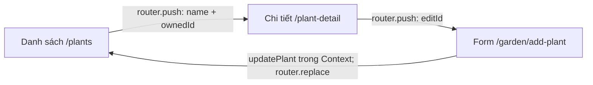
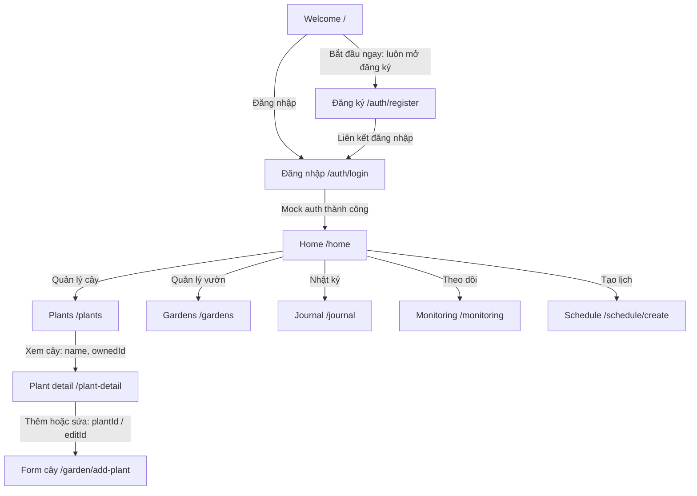

# Báo cáo xây dựng ứng dụng GoPlant

> Phạm vi báo cáo: phân tích source code hiện tại, tập trung vào React Native, Component/JSX, Props/State, danh sách dữ liệu và điều hướng. Đây là báo cáo về code đang có, không phải mô tả chức năng dự kiến.

> Nguồn nghiệp vụ bổ sung: `docs/FE1.txt` đã được đọc và dùng để đối chiếu luồng mong muốn. Bảng dưới đây phân biệt mô tả trong FE1 với hành vi xác minh được trong source; nội dung tài liệu không được xem mặc nhiên là chức năng đã triển khai.

## 3. Xây dựng ứng dụng

### 3.1. React Native, Component, JSX, Props/State

#### Cấu trúc source code chính

| Thư mục | Vai trò trong source hiện tại |
|---|---|
| `src/app/` | Route file-based của Expo Router. Mỗi file route thường chuyển tiếp đến một screen trong `src/features/`. `_layout.tsx` khai báo Stack gốc và các Provider dùng chung. |
| `src/features/` | Giao diện và logic theo tính năng: `auth`, `home`, `main`, `plants`, `gardens`, `schedule`, `journal`, `monitoring`, `account`, `welcome`. |
| `src/components/` | Component dùng lại giữa các màn hình như `AppTopBar`, `TabScreenTransition`, `AccountButton`, component theme và UI. |
| `src/services/` | Service hiện có gồm `mockAuth.ts`; đây là xác thực demo phía client, không phải API/backend. |
| `src/constants/` | Design token cơ bản trong `theme.ts`: màu GoPlant và tên font. |
| `src/hooks/`, `src/types/` | Hook giao diện và khai báo kiểu TypeScript dùng chung. |

Trong `src/app/_layout.tsx`, `RootLayout` tải font Plus Jakarta Sans, đặt `StatusBar`, sau đó bọc ứng dụng trong `AuthSessionProvider` và `PlantDataProvider`. Navigator gốc là Expo Router `Stack`; route screens ẩn header mặc định để từng màn hình tự hiển thị header riêng.

Một số route tiêu biểu:

| Route | File route | Nội dung được render |
|---|---|---|
| `/` | `src/app/index.tsx` | `WelcomeScreen` |
| `/auth/login`, `/auth/register` | `src/app/auth/login.tsx`, `register.tsx` | Màn hình đăng nhập và đăng ký |
| `/home` | `src/app/home.tsx` | `HomeScreen` |
| `/plants`, `/plant-detail` | `src/app/plants.tsx`, `plant-detail.tsx` | Danh sách cây và chi tiết cây |
| `/gardens`, `/garden-detail`, `/garden/create`, `/garden/add-plant` | Các file cùng tên trong `src/app/` | Vườn, tạo vườn và thêm/sửa hồ sơ cây |
| `/schedule`, `/schedule/create`, `/schedule/detail` | `src/app/schedule/` | Lịch chăm sóc và biểu mẫu liên quan |
| `/journal`, `/journal/new`, `/journal/edit`, `/journal/detail` | `src/app/journal/` | Nhật ký và biểu mẫu liên quan |
| `/monitoring`, `/monitoring/detail` | `src/app/monitoring/` | Theo dõi và chi tiết ghi nhận |
| `/search`, `/filter`, `/explore` | Các file cùng tên ở `src/app/` | Tìm kiếm, lọc và khám phá cây |
| `/account/...` | `src/app/account/` | Hồ sơ, cài đặt, bảo mật, quyền riêng tư và thông báo |

#### Component Tree của màn hình danh sách cây

```text
RootLayout
├── AuthSessionProvider
├── PlantDataProvider
└── Stack (Expo Router)
    └── /plants → PlantsScreen
        └── PageContent(kind="plants")
            ├── AppTopBar
            ├── TabScreenTransition
            ├── ScrollView
            │   └── EmptyPage(kind="plants")
            │       ├── Search TextInput
            │       ├── Action (thêm cây / lọc cây)
            │       ├── Section (cây sở hữu)
            │       │   ├── EmptyCard (khi danh sách rỗng)
            │       │   └── Plant card + Action (chi tiết / sửa / xóa)
            │       └── Section (cây yêu thích)
            └── BottomNav
```

Đây là cấu trúc của `PlantsScreen` trong `src/features/main/MainScreens.tsx`. `PageContent` tổ chức khung chung của trang; `EmptyPage` chọn nội dung theo `kind`; các component nhỏ đảm nhận phần trình bày và hành động cụ thể.

#### Component tái sử dụng và Props

- `Section` nhận `title`, `hint` và `children`, giúp các khối nội dung có cùng cấu trúc tiêu đề.
- `EmptyCard` nhận `icon`, `title`, `description`, `action`, `onPress` để hiển thị trạng thái rỗng cho vườn, cây, lịch, nhật ký và theo dõi.
- `Action` nhận `label`, `muted`, `onPress` để chuẩn hóa nút thao tác.
- `BottomNav` nhận `current` để xác định tab đang chọn và điều hướng giữa các route.
- `Field` trong `src/features/auth/AuthScreens.tsx` nhận nhãn, placeholder, icon, giá trị, callback cập nhật, lỗi và cấu hình nhập liệu; component này dùng chung cho form xác thực.
- `InfoRow` trong `PlantDetailScreen.tsx` nhận `label` và `value`, đồng thời hiển thị “Chưa có dữ liệu” khi giá trị rỗng.

Props giúp component con không phải tự tìm dữ liệu hoặc route. Ví dụ, `PageContent` truyền `kind` xuống `EmptyPage`; `Section` truyền tiêu đề và phần nội dung qua `children`; `EmptyCard` nhận callback để nút có hành vi do màn hình cha quyết định.

#### JSX minh họa

Đoạn dưới đây rút gọn từ phần render danh sách cây trong `MainScreens.tsx`:

```tsx
{visiblePlants.length === 0 ? (
  <EmptyCard
    icon="♧"
    title={plantQuery ? 'Không tìm thấy cây phù hợp' : 'Vườn của bạn chưa có cây'}
    description="Thử tên cây, tên khoa học hoặc vị trí khác."
  />
) : (
  visiblePlants.map((plant) => (
    <View key={plant.id} style={s.plantCard}>
      <Text>{plant.name}</Text>
      <Text>{plant.scientificName}</Text>
      <Action
        label="Chi tiết"
        onPress={() => router.push({
          pathname: '/plant-detail',
          params: { name: plant.name, ownedId: plant.id },
        } as never)}
      />
    </View>
  ))
)}
```

`View` tạo vùng bố cục; `Text` hiển thị nội dung; `Pressable` bên trong `Action` nhận thao tác chạm; `TextInput` nhập truy vấn; `ScrollView` cho phép cuộn nội dung. `key={plant.id}` giúp React nhận diện ổn định từng item. Điều hướng truyền `name` và `ownedId` để màn hình chi tiết tìm đúng hồ sơ cây.

#### State và cập nhật UI

- Trong `EmptyPage`, `plantQuery` là state cục bộ của màn hình. Mỗi lần nhập, `TextInput` gọi `setPlantQuery`; React render lại phần danh sách với kết quả lọc mới.
- `PlantDataProvider` quản lý `ownedPlants` và `favorites` bằng `useState`, rồi cung cấp qua React Context. `addPlant`, `updatePlant`, `removePlant` và `toggleFavorite` cập nhật state; những màn hình dùng `usePlantData()` nhận giá trị mới sau khi React render lại.
- Form thêm/sửa cây giữ các trường như tên, vị trí, ngày trồng và ghi chú trong state cục bộ. Khi hợp lệ, form thêm hoặc cập nhật `ownedPlants` trong context rồi thay route về `/plants`.
- `AuthSessionProvider` giữ `user` trong state bộ nhớ để màn hình chào hiển thị tên và màn hình đăng nhập cập nhật phiên demo. Trạng thái này không được lưu bền sau khi đóng ứng dụng.
- `LoginScreen` quản lý `account`, `password`, hiển thị mật khẩu, lỗi và `isSubmitting`. Sau khi mock auth thành công, màn hình đặt user vào context rồi điều hướng đến `/home`.

Component Tree và ví dụ code có thể tham chiếu tại [MainScreens.tsx](../src/features/main/MainScreens.tsx), [PlantDataStore.tsx](../src/features/plants/PlantDataStore.tsx), [AuthSession.tsx](../src/features/auth/AuthSession.tsx) và [AuthScreens.tsx](../src/features/auth/AuthScreens.tsx).

### 3.2. Hiển thị và xử lý danh sách dữ liệu

#### Các danh sách trong ứng dụng

- Danh sách cây trong thư viện cục bộ `plantCatalog`.
- Cây người dùng đã thêm vào `ownedPlants` và danh sách cây yêu thích `favorites`.
- Danh sách mẫu vườn, lịch chăm sóc, nhật ký và các lựa chọn category/filter trong những màn hình tương ứng.
- Danh sách cây trong form thêm cây, được lọc từ `plantCatalog` theo tên hiển thị hoặc tên khoa học.

Danh sách cây sở hữu và yêu thích lấy từ React Context, nhưng chỉ tồn tại trong bộ nhớ của ứng dụng. Các danh sách ở Home, vườn, lịch, nhật ký và theo dõi phần lớn là dữ liệu mẫu tĩnh được khai báo trong component. Source hiện không dùng `FlatList` hoặc `SectionList`; các item được render bằng `.map()` trong `ScrollView` dọc/ngang.

#### Render item, key và hành vi

Trong danh sách cây sở hữu, mỗi item dùng `plant.id` làm `key`. Item hiển thị tên cây, tên khoa học, nhóm cây, vị trí và thông tin ngày trồng. Các thao tác thực tế trong bản demo:

- **Chi tiết:** gọi `router.push('/plant-detail', { name, ownedId })`; màn hình đích dùng `ownedId` để tìm hồ sơ trong `ownedPlants`, rồi lấy thông tin nhận diện từ catalog.
- **Chỉnh sửa:** mở `/garden/add-plant` cùng `editId`; form đọc hồ sơ cây từ context và gọi `updatePlant` khi lưu hợp lệ.
- **Xóa:** mở hộp thoại xác nhận; nếu xác nhận, gọi `removePlant(id)`, cập nhật danh sách trong state bộ nhớ.
- **Thêm cây:** chọn item từ `plantCatalog`, nhập thông tin hồ sơ và gọi `addPlant`; sau đó `router.replace('/plants')` để quay lại danh sách đã cập nhật.
- **Yêu thích:** `PlantDetailScreen` gọi `toggleFavorite(plant.id)`; dữ liệu yêu thích được giữ trong Context trong phiên hiện tại.

Đoạn render và lọc thực tế (rút gọn) trong `src/features/main/MainScreens.tsx`:

```tsx
const normalized = plantQuery.trim().toLocaleLowerCase();
const visiblePlants = ownedPlants.filter((plant) =>
  `${plant.name} ${plant.scientificName} ${plant.location}`
    .toLocaleLowerCase()
    .includes(normalized)
);

{visiblePlants.map((plant) => (
  <View key={plant.id} style={s.plantCard}>
    <Text>{plant.name}</Text>
    <Action
      label="Chi tiết"
      onPress={() => router.push({
        pathname: '/plant-detail',
        params: { name: plant.name, ownedId: plant.id },
      } as never)}
    />
  </View>
))}
```

Ô tìm kiếm lọc theo tên hiển thị, tên khoa học và vị trí, không phân biệt hoa/thường sau khi chuẩn hóa. Nếu không có kết quả, màn hình dùng `EmptyCard` với nội dung khác nhau giữa trường hợp chưa có cây và truy vấn không khớp. Các filter chip đang có ở một số màn hình chỉ thay đổi lựa chọn giao diện; không phải tất cả đều lọc dữ liệu thật.

#### Trạng thái danh sách

| Trạng thái | Hiện trạng trong source |
|---|---|
| Loading | Không có loading state riêng cho danh sách cây vì nguồn hiện là state cục bộ đồng bộ, chưa gọi API. Màn hình đăng nhập có `isSubmitting`, nhưng đó không phải loading của danh sách. |
| Có dữ liệu | Cây sở hữu render theo `visiblePlants`; cây yêu thích được tính bằng cách đối chiếu `favorites` với `plantCatalog`. |
| Empty | Có `EmptyCard` cho danh sách chưa có cây/vườn/lịch/nhật ký và trường hợp tìm kiếm không có kết quả. |
| Error | Chưa có trạng thái lỗi tải dữ liệu từ server vì chưa tích hợp backend. Form có thông báo validation và thao tác demo có thể dùng `Alert`; đây không phải xử lý lỗi API. |
| Refresh | Chưa thấy pull-to-refresh hoặc luồng đồng bộ lại dữ liệu từ server. |

Hiện chưa có ảnh chụp màn hình runtime gắn trong báo cáo. Khi nộp báo cáo có yêu cầu hình ảnh, nên bổ sung ảnh chụp từ ứng dụng đang chạy trên Emulator; ảnh thiết kế Figma chỉ là tham chiếu, không chứng minh luồng dữ liệu hoạt động.

### 3.3. Navigation và truyền dữ liệu

#### Cấu trúc điều hướng

Project dùng **Expo Router file-based routing** với route files trong `src/app/`. `src/app/_layout.tsx` khai báo một `Stack` gốc, ẩn header mặc định. Các màn hình tự xây dựng header hoặc bottom navigation.

Thanh điều hướng chính trong `HomeScreen` và `MainScreens.tsx` được vẽ bằng các `Pressable`; đây không phải navigator `Tabs` của Expo Router. Khi người dùng chọn tab, code gọi `router.replace()` tới `/home`, `/gardens`, `/plants`, `/journal` hoặc `/monitoring`. Các màn hình chi tiết/form thường gọi `router.push()`, quay lại bằng `router.back()`, hoặc dùng `router.replace()` sau khi lưu.

#### Luồng minh họa: danh sách cây → chi tiết → chỉnh sửa



1. `PlantsScreen` render mỗi cây sở hữu và truyền hai route parameter `name` và `ownedId` qua `router.push`.
2. `PlantDetailScreen` đọc parameter bằng `useLocalSearchParams<{ name?: string; ownedId?: string }>()`. Nếu có `ownedId`, màn hình tìm hồ sơ sở hữu tương ứng trong `ownedPlants`; `name` là dữ liệu dự phòng để tra cứu cây trong catalog.
3. Nút chỉnh sửa chuyển đến `/garden/add-plant` với `editId`.
4. `GardenForm` dùng `editId` để nạp dữ liệu hiện có. Khi lưu hợp lệ, gọi `updatePlant(editId, profile)` trên Context rồi `router.replace('/plants')`. Danh sách cập nhật vì cùng Provider đang giữ state mới.

Luồng thêm mới tương tự: từ chi tiết cây catalog truyền `plantId` đến form; form khởi tạo cây được chọn, sau khi người dùng hoàn thành các trường cần thiết thì gọi `addPlant(profile)` và quay về `/plants`.

#### Giới hạn điều hướng và dữ liệu

- Route parameters chỉ chứa các chuỗi cần thiết để màn hình đích tìm dữ liệu; hồ sơ cây đầy đủ không được serialize vào URL.
- Cây thêm/sửa, favorite và phiên đăng nhập được giữ trong React Context nhưng không persistent; đóng ứng dụng sẽ làm mất dữ liệu demo.
- Tạo vườn, nhật ký và lịch chăm sóc hiện chủ yếu là giao diện xem trước; thao tác hợp lệ có thể chỉ hiển thị `Alert` thay vì ghi dữ liệu.
- Đăng nhập dùng `mockAuth.ts`; thành công chuyển đến `/home`, không có backend hoặc dashboard quản trị thật trong luồng này.

Các route và luồng trên được kiểm tra từ [src/app](../src/app/), [MainScreens.tsx](../src/features/main/MainScreens.tsx), [PlantDetailScreen.tsx](../src/features/plants/PlantDetailScreen.tsx), [GardenScreens.tsx](../src/features/gardens/GardenScreens.tsx) và [AuthScreens.tsx](../src/features/auth/AuthScreens.tsx).

#### Đối chiếu mô tả FE1 với source hiện tại

Bảng này bổ sung góc nhìn nghiệp vụ của FE1 vào phân tích kỹ thuật. “Mô tả FE1” là luồng mong muốn được người dùng cung cấp; “Hiện trạng code” chỉ phản ánh route và hành vi tìm thấy trong source. Các thao tác chỉ hiển thị giao diện hoặc dữ liệu mẫu không được xem là nghiệp vụ đã hoàn tất.

| Màn hình theo FE1 | Route thực tế | Mô tả dữ liệu/thao tác trong FE1 | Hiện trạng xác minh trong source và điểm cần lưu ý |
|---|---|---|---|
| Trang chào mừng | `/` | Giới thiệu GoPlant; “Bắt đầu ngay” đi đăng ký hoặc đăng nhập tùy việc đã có tài khoản; nút đăng nhập đi đến Login. | `WelcomeScreen` có thương hiệu, mô tả, thẻ tiện ích và hai nút. “Bắt đầu ngay” luôn mở `/auth/register`; nút đăng nhập mở `/auth/login`. Chưa có bước kiểm tra tài khoản để tự chọn route. |
| Đăng ký tài khoản | `/auth/register` | Nhập họ tên, email hoặc số điện thoại, email khôi phục, thiết bị chính, mật khẩu và xác nhận; đồng ý điều khoản; có liên kết đến đăng nhập. FE1 nêu xác minh là phần đang cân nhắc; đồng thời có ghi chú luồng hiện tại dự kiến đăng ký thành công rồi đến trang chủ. | Form có trường họ tên, email, email khôi phục tùy chọn, thiết bị, mật khẩu và xác nhận; có checkbox điều khoản và liên kết Login. Source kiểm tra dữ liệu nhưng khi gửi hợp lệ hiện thông báo dịch vụ chưa kết nối; không tạo tài khoản, không xác minh và không chuyển đến Home. Vì vậy ghi chú “đăng ký thành công → trang chủ” trong FE1 chưa khớp hành vi thực tế. |
| Đăng nhập | `/auth/login` | Nhập tài khoản và mật khẩu; đăng nhập đến Home; có “Quên mật khẩu” (đang xem xét/chưa làm), tùy chọn phương thức khác và liên kết đăng ký. | Có đăng nhập mock, trạng thái gửi, lỗi thông tin thiếu/sai; đăng nhập thành công gọi `signIn` và `router.replace('/home')`. Liên kết đăng ký mở `/auth/register`. Không có quy trình khôi phục mật khẩu hoặc đăng nhập xã hội đã xác minh. |
| Trang chủ | `/home` | Lời chào, thời tiết/nhắc nhở, tạo lịch, tìm kiếm/lọc, lối tắt, vườn/cây đang quản lý hoặc trạng thái rỗng, gợi ý, danh sách mong muốn và thanh điều hướng. | Có lời chào, trạng thái thời tiết “Chưa có dữ liệu”, nút tạo lịch, tìm kiếm và lọc, lối tắt, trạng thái rỗng vườn/cây, một số gợi ý, và bottom navigation tùy biến. Tìm kiếm mở `/search`; bộ lọc mở `/filter`; tạo lịch mở `/schedule/create`; lối tắt đi đến route tương ứng. Chưa xác minh có nhắc nhở hoạt động hoặc một danh sách mong muốn riêng trên Home; dữ liệu gợi ý là dữ liệu mẫu. |
| Quản lý vườn | `/gardens`, `/garden/create`, `/garden-detail` | Xem trạng thái và danh sách vườn; tạo vườn; mở để xem hoặc sửa thông tin. | `/gardens` hiện hiển thị trạng thái rỗng và thao tác tạo; `/garden/create` có form nhưng khi hợp lệ báo chưa lưu do chưa có backend. `/garden-detail` trình bày vườn và cây mẫu. Chưa có danh sách vườn người dùng được lưu hoặc thao tác cập nhật vườn đã xác minh. |
| Quản lý cây | `/plants`, `/plant-detail`, `/garden/add-plant` | Thêm cây; xem cây sở hữu, yêu thích, gợi ý, cây xem gần đây; xem/sửa/xóa/chuyển cây vào vườn/xem lại cây. | `/plants` hiển thị cây sở hữu và yêu thích, tìm kiếm theo tên/tên khoa học/vị trí; có thêm, chi tiết, sửa, xóa và xác nhận xóa. Thêm/sửa/xóa cây cập nhật Context trong bộ nhớ. Catalog có thể được khám phá qua `/search` và `/explore`; chi tiết hỗ trợ yêu thích hoặc thêm cây vào danh sách sở hữu. Chưa thấy luồng “vừa xem gần đây”, chuyển cây từ wishlist vào một vườn cụ thể, hoặc danh sách wishlist riêng như FE1 mô tả. |
| Nhật ký | `/journal`, `/journal/new`, `/journal/edit`, `/journal/detail` | Xem nhật ký phát triển theo cây/vườn; xem chi tiết, chỉnh sửa; ghi ảnh là nội dung đang xem xét. | Trang `/journal` hiện là empty state. Có route form mới/sửa và trang chi tiết với nội dung mẫu. Form kiểm tra trường nhưng không lưu vì chưa có backend; ảnh không được tải lên và thao tác thêm ảnh báo camera chưa bật. Chưa có dữ liệu nhật ký thực hoặc nhật ký theo từng vườn được lưu. |
| Theo dõi và ghi nhận | `/monitoring`, `/monitoring/detail` | Thêm ghi nhận; xem tiến độ/trạng thái; xem chỉ số vườn và chi tiết ghi nhận cây. | `/monitoring` hiện là empty state. Có route `/monitoring/detail` với nội dung trình bày mẫu; chưa có ghi nhận hoặc chỉ số cảm biến thật. FE1 không cung cấp schema metric/đơn vị/nguồn dữ liệu, nên không thể kết luận các giá trị mẫu là số liệu thực. |
| Lập lịch chăm sóc | `/schedule`, `/schedule/create`, `/schedule/detail` | Tạo lịch, xem lịch cây/vườn đang sở hữu, mở chi tiết hoặc thêm lịch cho cây. | `/schedule` hiện hiển thị empty state và điều hướng tạo lịch. Form tạo lịch có trường nhập/validation, nhưng khi gửi hợp lệ chỉ thông báo bản xem trước chưa lưu. Route chi tiết có nội dung mẫu; chưa có lịch được lưu, nhắc nhở hệ thống hoặc đồng bộ lịch thật. |

#### Luồng điều hướng được mô tả và luồng đã có



Sơ đồ thể hiện route hiện có trong source, không thể hiện luồng tương lai chưa triển khai. Mô tả FE1 nói nút “Bắt đầu ngay” có thể chọn đăng ký hoặc đăng nhập theo trạng thái tài khoản, nhưng code hiện tại luôn mở form đăng ký. Tương tự, các thao tác đăng ký, tạo vườn, lưu nhật ký và lưu lịch không tạo bản ghi backend; không nên mô tả chúng là luồng nghiệp vụ hoàn chỉnh trong báo cáo sản phẩm.

#### Phân biệt hành vi đang chạy và dữ liệu minh họa

- **Có xử lý trạng thái phía ứng dụng:** xác thực mock ở Login; quản lý cây sở hữu/yêu thích trong React Context; tìm kiếm và lọc catalog/cây sở hữu; điều hướng đến các route hiện có.
- **Có giao diện nhưng chưa lưu dữ liệu:** đăng ký, tạo vườn, tạo/sửa nhật ký và tạo lịch. Các form có thể kiểm tra một số trường rồi hiển thị thông báo rằng dịch vụ/backend chưa kết nối.
- **Dữ liệu mẫu hoặc trạng thái chưa có dữ liệu:** chi tiết vườn, nội dung lịch/nhật ký mẫu, gợi ý cây và các màn hình chi tiết theo dõi. Không dùng nội dung này làm bằng chứng về cảm biến, lịch sử hoặc đồng bộ thật.
- **Chưa được xác minh trong source:** khôi phục mật khẩu, xác thực đăng ký, social login, nhắc nhở thực, cây xem gần đây và chuyển cây mong muốn vào vườn cụ thể.

Các trạng thái trên là mô tả source code, không phải kết quả chạy lại ứng dụng hoặc kiểm thử Emulator trong lần cập nhật báo cáo này.

## Kết luận

Source hiện đã có cấu trúc feature-based trên nền Expo Router, component nhỏ có Props rõ ràng, state cục bộ cho form/tìm kiếm và Context cho cây sở hữu/yêu thích cùng phiên mock. Danh sách chủ yếu render bằng `ScrollView` và `.map()`, chưa dùng `FlatList`; một số danh sách là dữ liệu demo. Luồng thêm/sửa cây có cập nhật state trong phiên, trong khi vườn, lịch và nhật ký chưa có lưu trữ backend. Báo cáo không kết luận các luồng đã được kiểm thử trên Emulator trong lượt phân tích này.
